# Board App · 开发板应用项目

> 一个运行在 aarch64 Linux 开发板上的 LVGL 9.2 应用集合：**AI 聊天（带可复用中文输入法）、聊天室（TCP/UDP 通信模块）、天气查询、可编辑相册、三款开源小游戏**。
> 屏幕基准 1024×600，触摸操作，简约风格；UI 与核心代码物理分离。

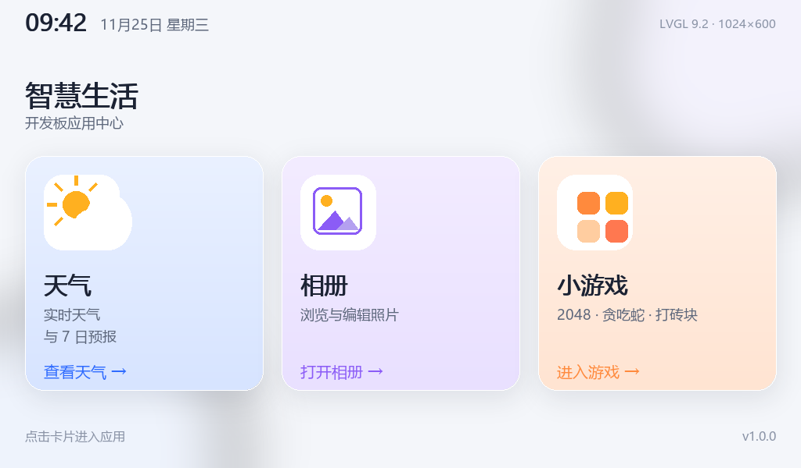

## 1. 功能

| 应用 | 功能 |
|---|---|
| 主界面 | 时间/日期、5 张卡片（聊天室 / AI 聊天 / 天气 / 相册 / 小游戏）、右上角账号胶囊、统一返回与转场 |
| AI 聊天 | 左半屏对话（气泡、滚动、发送）+ 右半屏虚拟键盘；中文拼音候选、中/英切换、常用语；在线大模型（OpenAI 兼容，**DeepSeek HTTPS 直连**，默认 `deepseek-flash`；key 可用 `./ai_key` 存本地）与离线助手自动兜底 |
| 系统账户 | 全系统统一账号（首页顶栏进入）：登录/注册、好友管理、记住账号并**开机自动登录**；聊天室与围棋共用同一连接 |
| 聊天室 | 好友列表与在线状态、私聊（TCP 可靠）、群聊广播（UDP）、离线消息补发、**聊天记录本地持久化**；服务器是独立命令行程序，数据本地持久化 |
| 联网围棋 | 小游戏子模块：好友邀请、9/13/19 路、服务器权威判定；规则核心移植自 weiqi.js（ISC） |
| 输入法 | **LVGL 自带开源拼音输入法**封装成通用组件 `board_ui/ui_ime`，任何页面挂上 textarea 即可复用；词库 401 音节 / 6763 字 |
| 天气 | 当前天气、湿度、风力、未来 7 天（历史补齐）、8 城市切换、刷新、1 小时缓存、离线/演示兜底 |
| 相册 | 图片网格、大图查看、旋转/翻转/灰度/亮度/对比度/裁剪、撤销/重置、另存 PNG |
| 小游戏 | 2048、贪吃蛇、打砖块、联网围棋；暂停/继续、重开、结算、最高分持久化（4 款卡片自适应一行排开） |

**游戏规则核心来自 GitHub 开源项目** [Little World Arcade](https://github.com/Start66613/littleworld-arcade)（MIT，commit `106fb20`），本项目只写 LVGL UI 与适配层，不自己实现游戏规则。

**中文输入法引擎来自 LVGL 自带的 `lv_ime_pinyin`**（MIT），候选词库由 [Unicode Unihan](https://www.unicode.org/Public/UCD/latest/ucd/Unihan.zip) 的 GB 2312 汉字生成。

## 2. 设计图

| 主界面 | 天气 |
|---|---|
|  | 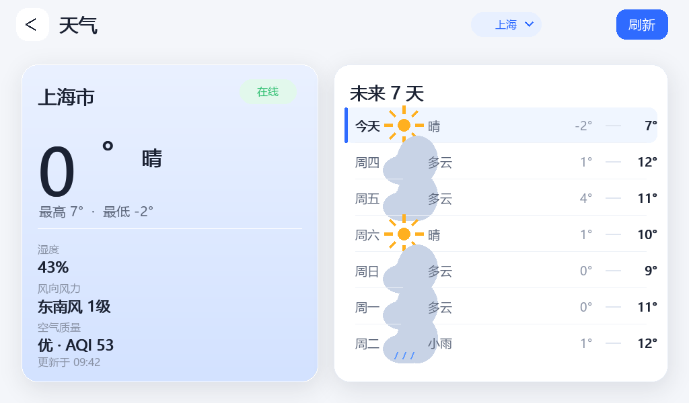 |

| 相册 | 图片编辑 |
|---|---|
| 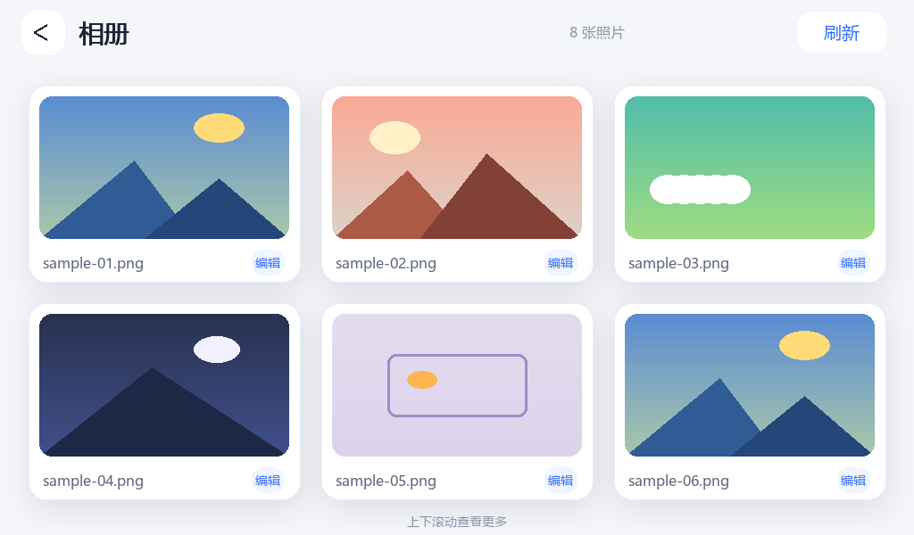 | 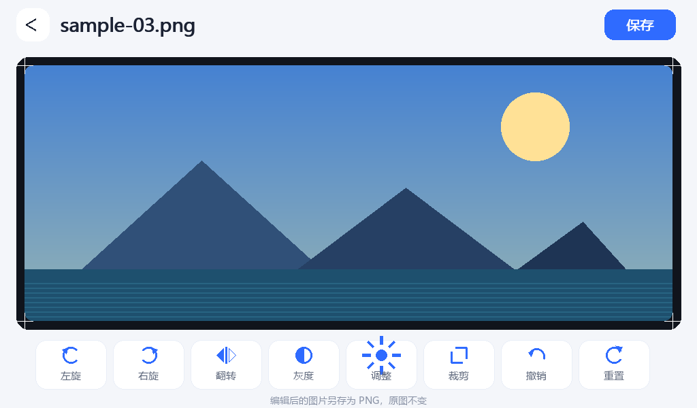 |

| 小游戏中心 |
|---|
| 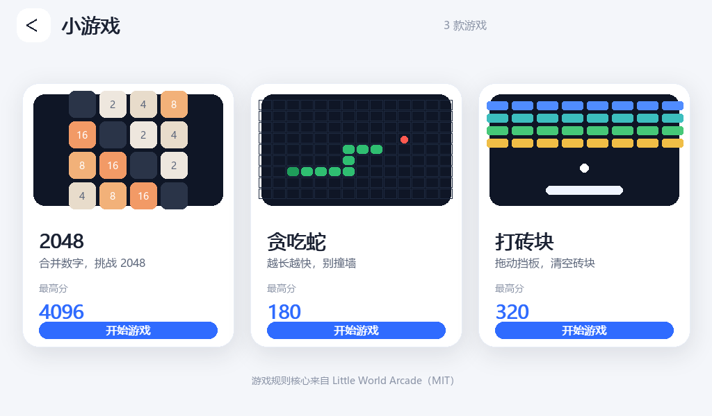 |

> 设计图为评审基线；实现以 `docs/04-ui-design.md` 的尺寸/令牌为准。

## 3. 架构一句话

```text
main.c（fbdev/evdev）
  └─ board_app/
       ├─ core/       纯 C：HTTP、JSON、存储、图片、游戏规则（无 LVGL）
       ├─ ui/         LVGL：主题、组件、导航
       ├─ main_page/  首页
       └─ app/        weather / gallery / games（各自 core + ui）
```

- `board_core` 不链接 LVGL；`board_ui` 链接 `board_core + lvgl`。链接期强制前后端分离。
- 核心逻辑可在 x86_64 主机单元测试；UI 在板上点检。
- 天气 worker 通过线程安全队列把结果交给 UI 线程，worker 不碰 `lv_*`。
- **新增应用只需在 `app/` 下新建文件夹并 `BOARD_APP_REGISTER`**：CMake 自动 glob 源文件，首页/游戏中心自动生成卡片，无需改中心代码。

详细设计见 [02 总体架构](docs/02-architecture.md)。

## 4. 目录

```text
board_app/
├── README.md                 本文件
├── CMakeLists.txt            board_core / board_ui / board_app + 自检工具 target
├── board_app.c/.h            启动引导（路径/存储/主题/会话/自动登录）
├── main_page/home_ui.c       首页（5 张卡片 + 顶栏账号胶囊）
├── integration/              ★ 接入原始 lv_port_linux 所需文件（见 4.1 节）
│   ├── main.c                入口（调 board_app_init）
│   ├── CMakeLists.txt        顶层构建（含 board_app 子目录 + -ldl）
│   └── lv_conf.h             LVGL 配置（TinyTTF / 拼音输入法 / 内存）
├── core/                     跨应用核心（无 LVGL）
│   ├── include/board_core/   paths time log error storage async http_client tls_client
│   ├── src/                  对应实现 + stb_impl.c
│   └── third_party/{cjson,stb}/
├── ui/                       UI 框架（LVGL）
│   ├── include/board_ui/     theme widgets icons app_manager async ime comm_session
│   └── src/
├── app/
│   ├── chat/{core,ui}/       AI 聊天（LLM 请求/解析/离线助手 + 页面）
│   ├── comm/{core,ui}/       聊天室（协议/socket/客户端/聊天记录 + 页面）
│   ├── account/ui/           系统账户（登录/注册/好友管理）
│   ├── weather/{core,ui}/    天气
│   ├── gallery/{core,ui}/    相册
│   └── games/
│       ├── core/ ui/         游戏中心
│       ├── g2048/ snake/ breakout/
│       └── weiqi/{core,ui}/  联网围棋（规则移植自 weiqi.js）
├── assets/                   字体 / 拼音词库 / 示例照片
├── data/                     运行时数据（settings.conf、comm_history、cache）
├── third_party/              littleworld_arcade、weiqi-js（含许可与 UPSTREAM）
├── tests/
│   ├── host/                 主机单元测试（含围棋、通信）
│   └── preview/              主机 headless 预览（导出截图）
├── tools/                    部署/字体子集/词库生成/自检工具/诊断脚本
└── docs/                     文档 00~14（先读 00-index.md）
```

服务器在 board_app 之外（同级的 `server/`，独立构建，不链接 LVGL）：
`server.c`（TCP/UDP + 控制台）、`store.c`（账号/好友/离线）、`game.c`（围棋对局）、
`sha256.c`（口令散列）、`tools/`（测试客户端 + 联调脚本）。

完整逐文件说明见 [03 目录结构与编码规范](docs/03-directory-and-coding.md)。

## 4.1 在原始 lv_port_linux 上构建（给别人看的第一步）

本仓库只包含 `board_app/`。真正的程序要构建在 LVGL 官方的 lv_port_linux 工程里
（它有 `lvgl/` 子模块和 fbdev/evdev 驱动）。三个**必须替换**的文件放在
[`integration/`](integration/README.md)：

| 文件 | 作用 |
|---|---|
| `integration/main.c` | 入口：`lv_init` → fbdev/evdev → `board_app_init(argv[0])` → 主循环 |
| `integration/CMakeLists.txt` | 顶层构建：`add_subdirectory(board_app)`、`--whole-archive`（应用自动注册）、`-ldl`、可选 glibc 2.27 sysroot |
| `integration/lv_conf.h` | LVGL 配置：TinyTTF、拼音输入法、4 MB 内存池、`LV_FS_STDIO_CACHE_SIZE 0` |

```bash
# 1) 干净的 lv_port_linux + lvgl 子模块（9.2.x）
git clone https://github.com/lvgl/lv_port_linux.git
cd lv_port_linux && git submodule update --init --recursive

# 2) 放入本仓库，并覆盖三个接入文件
git clone git@github.com:7L-jingzhe/board-app.git board_app
cp board_app/integration/main.c          ./main.c
cp board_app/integration/CMakeLists.txt  ./CMakeLists.txt
cp board_app/integration/lv_conf.h       ./lv_conf.h

# 3) 构建（aarch64 交叉编译；先准备 sysroot）
bash board_app/tools/setup_bionic_sysroot.sh
cmake -S . -B build_board_app && cmake --build build_board_app -j8
file bin/main        # => ELF ... ARM aarch64
```

> 还有一处对上游文件的改动：`lvgl/CMakeLists.txt` 的 `project(... LANGUAGES C CXX ASM)`
> 要改成 `C ASM`（板端没有 C++ 交叉编译器）。升级 LVGL 后需要重新改一次。
> 详细说明（含三个文件相对上游改了什么）见 [`integration/README.md`](integration/README.md)。

如果只想在本机（x86_64）看界面，用 `tests/preview` 的 headless 预览，不需要板子。

## 5. 快速开始（WSL，本机开发用）

> 如果是在别人的 lv_port_linux 上从零接入，请先按 [4.1 节](#41-在原始-lv_port_linux-上构建给别人看的第一步) 放好三个接入文件；
> 本节假设 `board_app/` 已经在你的工程里，讲的是日常「改代码 → 编译 → 部署」。

> 编译必须在 WSL 的 ext4 目录进行，不要在 `/mnt/d` 上直接构建。

```bash
# 1) 同步源码到 WSL ext4（按实际路径修改）
SRC=/mnt/d/data/code-files/c/embedded-systems-study/lvgl/lv_port_linux-release-v9.2
DST=/home/jingzhe/lvgl/lv_port_linux-release-v9.2
rsync -a --delete "$SRC/board_app/" "$DST/board_app/"
rsync -a "$SRC/CMakeLists.txt" "$SRC/main.c" "$SRC/lv_conf.h" "$DST/"

# 2) 准备板端兼容的 glibc 2.27 sysroot（只需一次；默认 $HOME/aarch64-bionic）
bash board_app/tools/setup_bionic_sysroot.sh

# 3) 交叉编译
cd "$DST"
rm -rf build_board_app
cmake -S . -B build_board_app -DCMAKE_BUILD_TYPE=Release
cmake --build build_board_app -j8

# 4) 验证
file bin/main       # 期望 aarch64；NEEDED 为板端 libc/libm/libpthread
```

主机测试：

```bash
cmake -S board_app/tests/host -B build_host_tests
cmake --build build_host_tests -j8
ctest --test-dir build_host_tests --output-on-failure
```

一键部署（同步 → 单测 → 交叉编译 → 上传 → 重启自检）：

```bash
bash board_app/tools/deploy.sh --with-server    # 连聊天/围棋服务器一起部署
```

板端首次使用建议配一次 AI key（之后启动就不用带环境变量）：

```bash
cd /root/lvgl/board_apps
./ai_key sk-xxxxxxxx
./main
```

部署/运行/故障排查见 [06 构建、部署与运行](docs/06-build-deploy.md)。

如果板子每次重启换 IP：优先在路由器/DHCP 服务器按 MAC 做固定租约（板子仍走 DHCP）；
临时定位可用 `pwsh -File board_app/tools/find_board.ps1` 扫描当前地址。

### 主机 UI 预览

```bash
cd /home/jingzhe/lvgl/lv_port_linux-release-v9.2
cmake -S board_app/tests/preview -B build_preview -DCMAKE_BUILD_TYPE=Debug
cmake --build build_preview -j8
BOARD_APP_ROOT=$PWD/board_app \
PREVIEW_OUT=$PWD/board_app/docs/screenshots \
./build_preview/board_preview
```

预览会真实执行聊天页输入拼音（导出候选条）、切换城市、旋转/灰度/撤销/裁剪/保存、2048 移动、打砖块发球等交互，并导出 `docs/screenshots/`。

### 聊天页接入大模型（可选）

```bash
export BOARD_APP_AI_URL=http://192.168.1.10:11434/v1   # OpenAI 兼容 base_url
export BOARD_APP_AI_MODEL=qwen2.5:3b                   # 可选，默认 qwen2.5:3b
export BOARD_APP_AI_KEY=sk-xxx                         # 可选
./main
```

不配置也能用：自动走离线助手（报时间、四则运算、输入法说明）。细节见
[11 AI 聊天与可复用输入法](docs/11-chat-and-ime.md)。

### 输入法词库/字体重新生成

```bash
python3 tools/gen_pinyin_dict.py --unihan /tmp/Unihan.zip --output assets/ime/pinyin_dict.txt
python3 tools/gen_chars.py board_app
python3 tools/gen_font_subset.py --input /tmp/NotoSansSC-VF.ttf \
        --chars assets/fonts/chars.txt --output assets/fonts/NotoSansSC-Board.ttf
python3 tools/check_font_coverage.py assets/fonts/NotoSansSC-Board.ttf \
        assets/ime/pinyin_dict.txt        # 必须 missing: 0
```

> 字体必须覆盖所有候选汉字，且必须**整包读入内存**（见 11 文档的性能章节），否则板上会出现方框或极慢。

## 6. 文档

从 [docs/00-index.md](docs/00-index.md) 开始。建议顺序：

1. [需求规格](docs/01-requirements.md)
2. [总体架构](docs/02-architecture.md)
3. [UI 与交互](docs/04-ui-design.md)
4. [模块接口](docs/05-module-api.md)
5. [构建部署](docs/06-build-deploy.md)
6. [测试验收](docs/07-test-acceptance.md)

## 7. 当前状态

| 阶段 | 状态 |
|---|---|
| P0 文档与设计 | ✅ 完成：文档 + 5 张设计图 |
| P1 骨架与构建 | ✅ 完成：WSL aarch64 交叉编译，已在板端运行（glibc 2.27 sysroot） |
| P2 主界面与框架 | ✅ 完成：首页/导航/主题 |
| P3 天气 | ✅ 板端在线验证：wttr.in 广州实时 17℃；1 小时缓存过期重取；历史补齐 7 天 |
| P4 相册 | ✅ 板端网格验证；编辑/裁剪/保存已在主机预览验证 |
| P5 小游戏 | ✅ 板端验证：2048/贪吃蛇/打砖块 + 联网围棋（4 卡片一行） |
| P6 输入法与 AI 聊天 | ✅ 板端验证：`ui_ime` 复用组件；DeepSeek 实际对话通过（HTTPS 直连） |
| P7 联机通信 | ✅ 板端验证：聊天室（私聊/群聊/离线补发/聊天记录）+ 联网围棋对局 |
| P8 系统账户 | ✅ 板端验证：统一登录、记住账号、开机自动登录 |
| P6 集成与验收 | ◐ 板端显示/网络/页面通过；**触摸手势、20 次进出、自启待现场** |
| P7 交付文档 | ◐ 进行中：README/截图/许可证 |

> 已在 `192.168.64.200` 的 RK356X（Buildroot/glibc 2.29）上部署到
> `/root/lvgl/board_apps/`，并通过 `/dev/fb0` 截取主界面、天气、相册、游戏中心、2048。
> 发布版已关闭 LVGL 的样式/内存/对象完整性断言，板端首页启动约 250 ms。
> 触摸手势与长时间稳定性仍需现场人工点检。

## 7.1 开发板实机截图

| 主界面 | 天气（在线） |
|---|---|
| 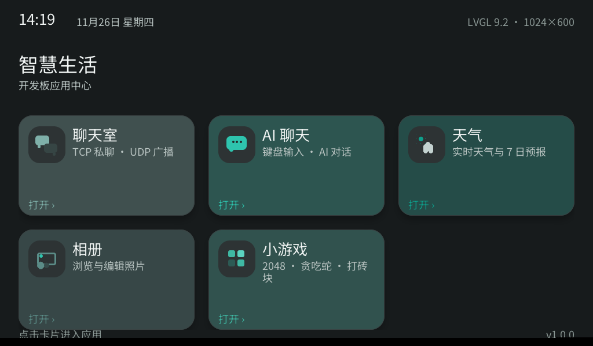 | 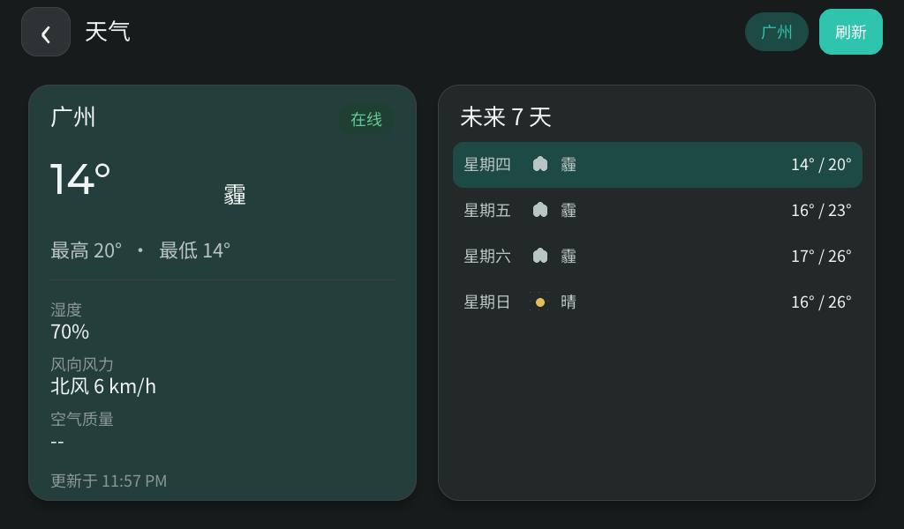 |

| 相册 | 游戏中心 |
|---|---|
|  | 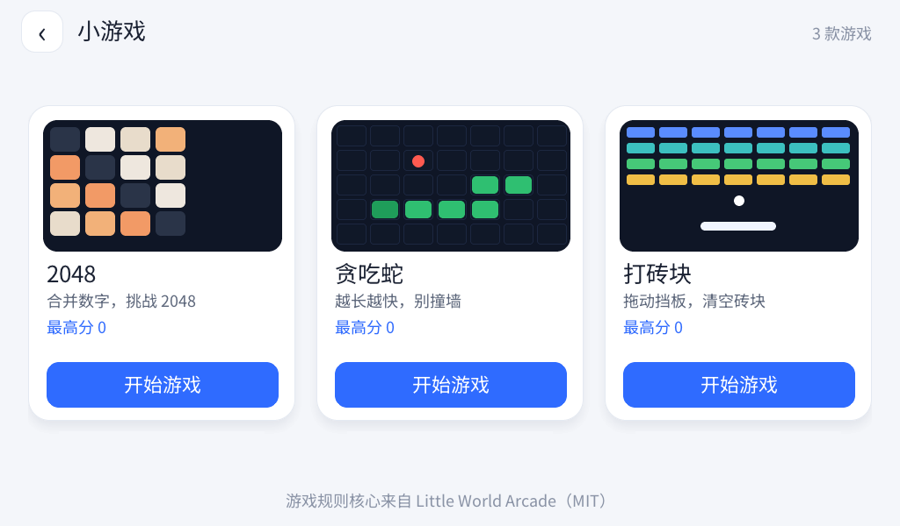 |

## 7.2 主机预览截图

| 主界面 | 天气 |
|---|---|
| 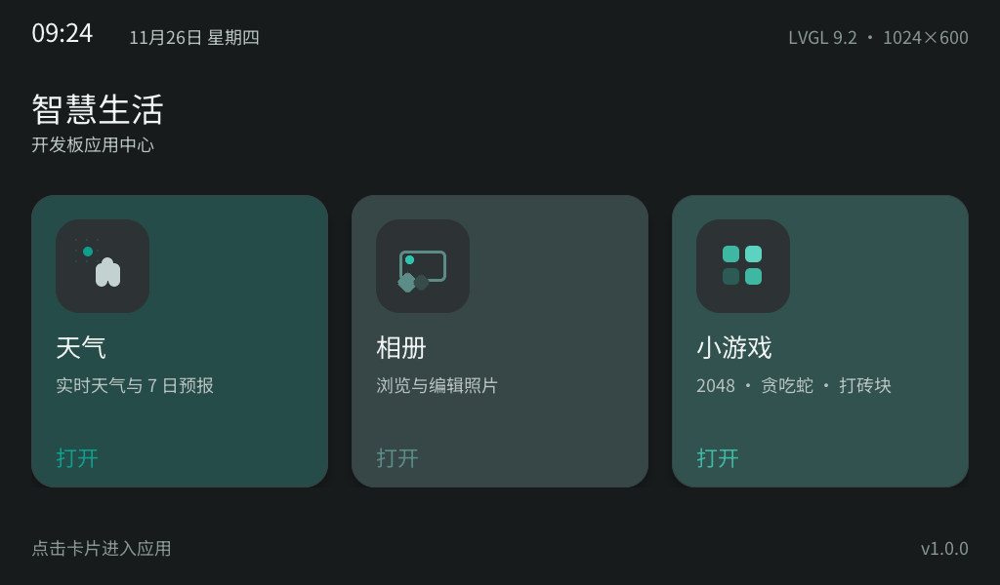 | 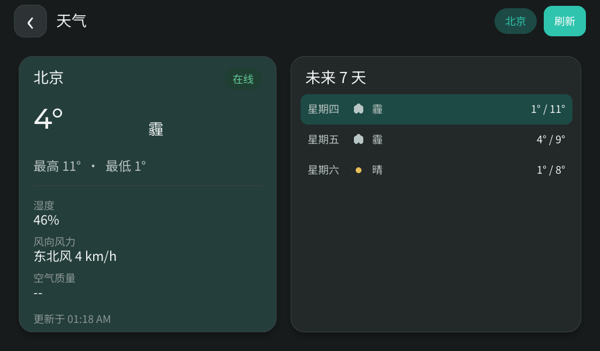 |

| 相册 | 编辑器 |
|---|---|
| 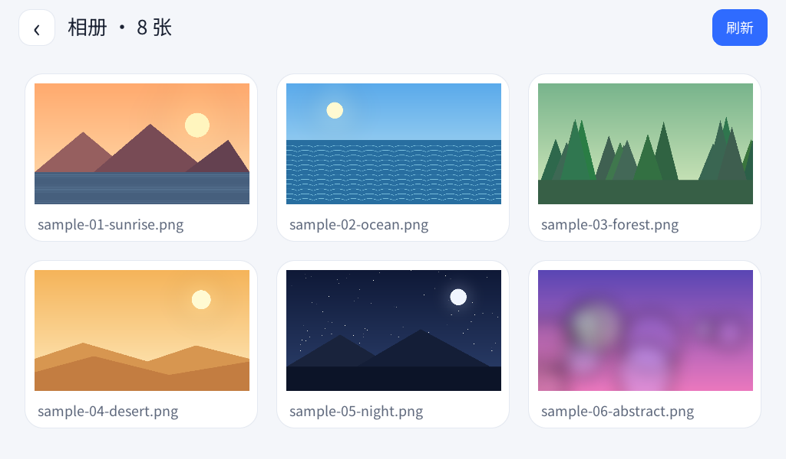 | 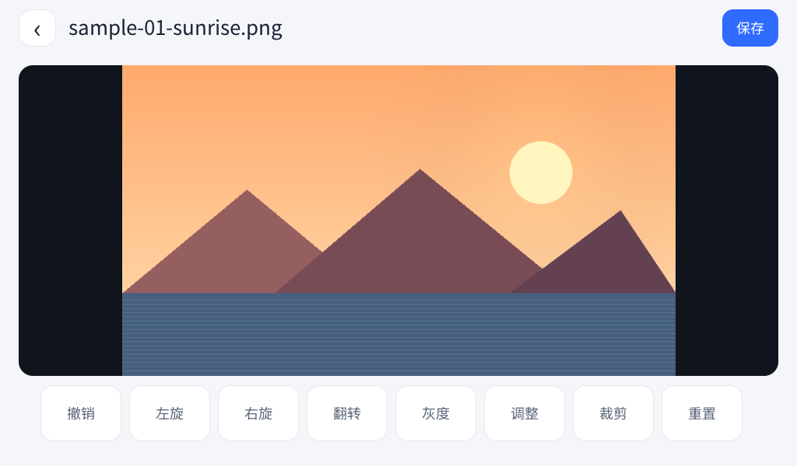 |

| 游戏中心 | 2048 |
|---|---|
| 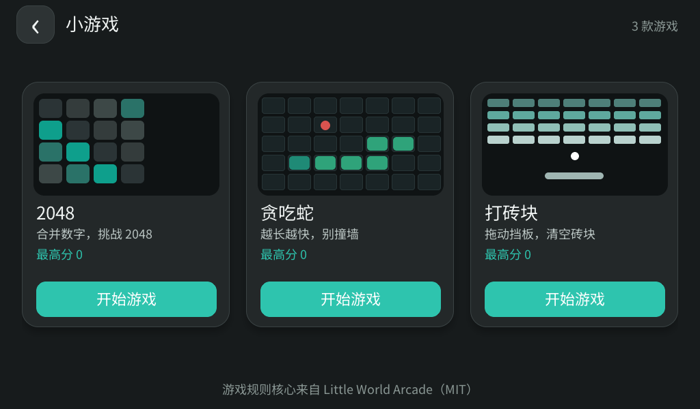 | 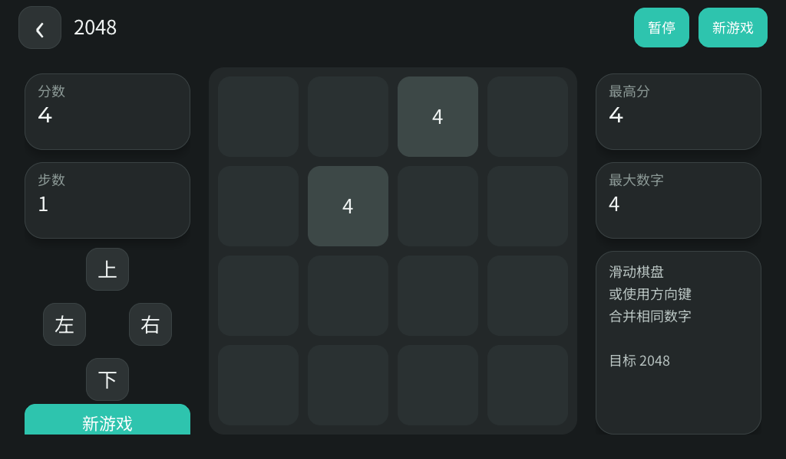 |

## 8. 许可证

- 本项目代码：MIT（见 [LICENSE](LICENSE)）。
- 第三方：LVGL（MIT）、Little World Arcade（MIT）、cJSON（MIT）、stb（Public Domain/MIT）、Noto Sans SC（OFL-1.1）。
- 示例图片：CC0 1.0。

详见 [09 第三方开源与许可证](docs/09-third-party-licenses.md)。

## 9. 维护

新增应用/游戏、替换天气源、重新生成字体、升级 LVGL，见 [08 维护与扩展指南](docs/08-maintenance.md)。
