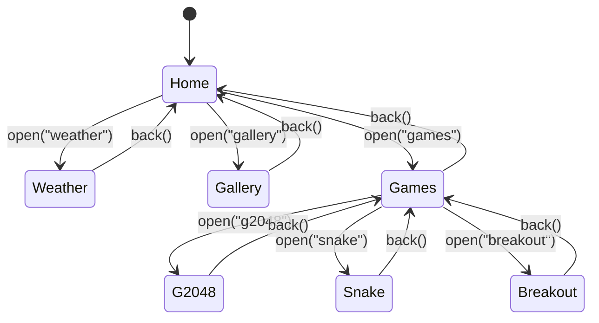
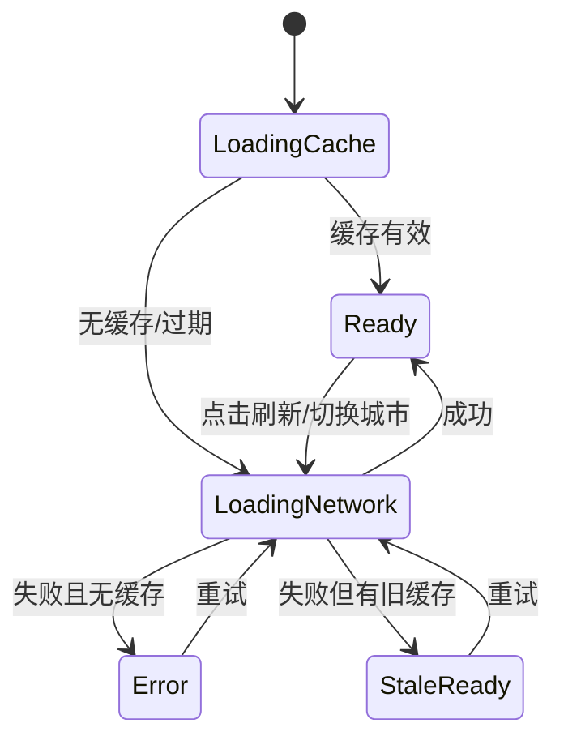
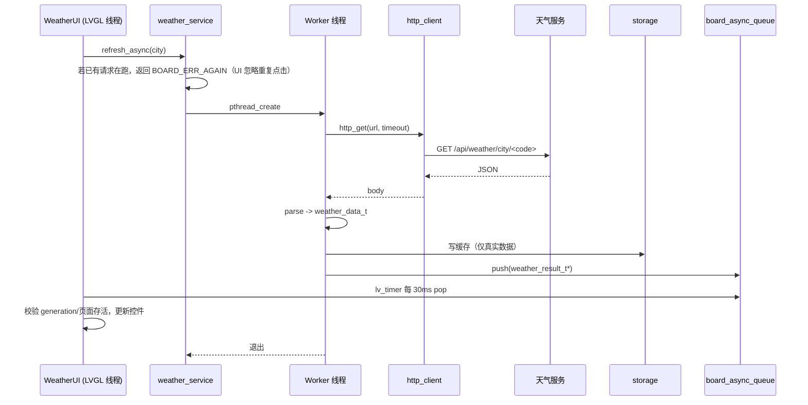
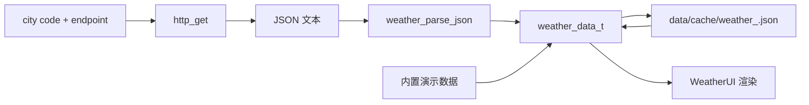
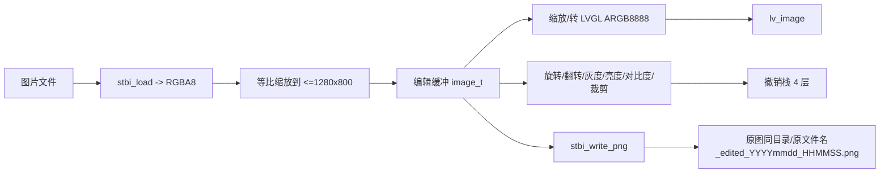
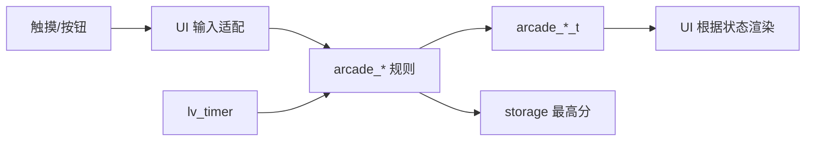
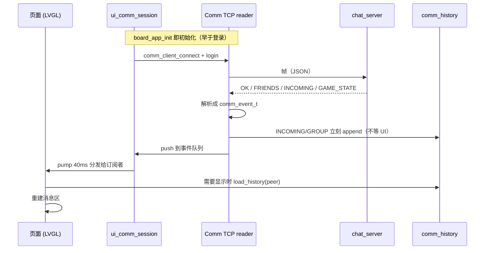
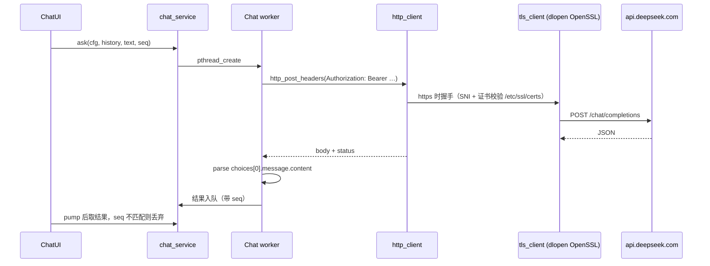
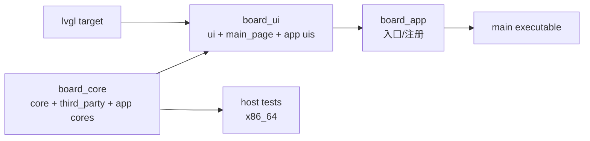

# 总体架构设计

> 文档编号：02
> 状态：与实现同步（2026-11-27）
> 关联：01 需求、03 目录规范、05 模块接口

## 1. 设计目标

1. **前后端分离**：业务规则/数据处理（core）与 LVGL 渲染/输入（ui）互不依赖。
2. **单向依赖**：`ui → core`，`core` 不反向依赖 `ui`；`core` 不包含 `lvgl.h`。
3. **可测试**：核心库在 x86_64 Linux 上可直接编译运行单元测试。
4. **可扩展**：新增应用只需实现 `app_desc_t` 并注册；新增游戏只需提供核心库 + UI 适配。
5. **可回收**：每个页面退出时显式释放定时器、线程、图片、临时缓冲；连续进出不泄漏。
6. **可移植**：UI 以 1024×600 为基准，但布局使用 flex/grid/百分比，不散落硬件坐标。

## 2. 系统上下文

```mermaid
flowchart LR
    User[用户] -->|触摸| Touch[/dev/input/event6]
    Touch --> LVGL[LVGL 9.2 输入/渲染]
    LVGL --> App[Board App]
    App -->|HTTP GET| WeatherAPI[天气服务<br/>wttr.in]
    App -->|读写| FS[(assets/ 与 data/)]
    App -->|fbdev| FB[/dev/fb0]
    App -->|pthread| Worker[天气工作线程]
    Worker --> WeatherAPI
    Worker -->|结果队列| App
```

运行时只有一个 UI 线程（主线程）调用 LVGL；天气请求在独立 worker 线程中完成，通过线程安全的 `board_async_queue` 投递结果，UI 线程用 `lv_timer` 每 30 ms 排空队列。worker 从不直接调用 LVGL。

## 3. 分层架构

```mermaid
flowchart TB
    subgraph AppLayer[应用层 / application]
        Home[main_page 首页]
        WeatherUI[app/weather/ui]
        GalleryUI[app/gallery/ui]
        GamesUI[app/games/ui + 各游戏 ui]
        ChatUI[app/chat/ui AI 聊天]
        CommUI[app/comm/ui 聊天室]
        AccountUI[app/account/ui 系统账户]
        WeiqiUI[app/games/weiqi/ui 联网围棋]
    end

    subgraph UIFramework[UI 框架层 / ui]
        Theme[theme 主题/字体]
        Widgets[widgets 通用组件]
        Nav[app_manager 导航/栈/转场]
        Async[async 主线程投递]
        Ime[ui_ime 可复用输入法]
        Session[ui_comm_session 登录态/事件多播]
    end

    subgraph CoreLayer[核心层 / core]
        WeatherCore[weather: 模型/解析/缓存/服务]
        GalleryCore[gallery: 扫描/图像处理/保存]
        GameCore[games: 游戏规则核心（第三方）]
        WeiqiCore[weiqi: 规则核心（weiqi.js 移植）]
        ChatCore[chat: LLM 请求/解析/离线助手]
        CommCore[comm: 协议/socket/客户端/聊天记录]
        Storage[storage 设置/分数/缓存]
        HTTP[http_client: HTTP + HTTPS]
        TLS[tls_client: 运行时 dlopen OpenSSL]
        JSON[cJSON]
        Image[stb_image / stb_image_write]
        Time[board_time]
        Log[log]
        Paths[board_paths]
    end

    subgraph Platform[平台层]
        LVGL[LVGL 9.2]
        POSIX[POSIX: pthread/socket/fs]
        Board[fbdev + evdev]
    end

    Home --> Nav
    WeatherUI --> Nav
    GalleryUI --> Nav
    GamesUI --> Nav
    Home --> Theme
    WeatherUI --> Theme
    GalleryUI --> Theme
    GamesUI --> Theme
    Home --> Widgets
    WeatherUI --> Widgets
    GalleryUI --> Widgets
    GamesUI --> Widgets
    Nav --> Async

    WeatherUI --> WeatherCore
    GalleryUI --> GalleryCore
    GamesUI --> GameCore
    WeatherCore --> HTTP
    WeatherCore --> Storage
    WeatherCore --> JSON
    GalleryCore --> Image
    GalleryCore --> Storage
    GameCore --> Storage
    ChatUI --> ChatCore
    CommUI --> CommCore
    CommUI --> Session
    AccountUI --> Session
    WeiqiUI --> Session
    WeiqiUI --> WeiqiCore
    Session --> CommCore
    ChatCore --> HTTP
    ChatCore --> Storage
    CommCore --> Storage
    HTTP --> TLS
    HTTP --> POSIX
    TLS --> POSIX
    GalleryCore --> POSIX
    Storage --> POSIX
    Nav --> LVGL
    Theme --> LVGL
    Widgets --> LVGL
    Async --> LVGL
    LVGL --> Board
```



**依赖规则**

| 层 | 可以依赖 | 禁止依赖 |
|---|---|---|
| `main_page/`、`app/*/ui/` | `ui/`、`core/`、LVGL | 其他应用的 `ui/` |
| `ui/` | `core/`、LVGL | 具体应用的业务实现（只提供通用组件） |
| `app/*/core/` | `core/` 公共服务、C 标准库、POSIX | LVGL、其他应用的 core、`ui/` |
| `core/` | C 标准库、POSIX、第三方纯 C 库 | LVGL、任何 `app/` |
| `ui/`（`ui_comm_session`） | `core/`、`app/*/core/`、LVGL | 具体应用的 UI |
| `server/` | C 标准库、POSIX、`app/*/core/` 的纯 C 模块（协议/围棋规则） | **LVGL、任何 `app/*/ui/`** |

**CMake 强制**：`board_core` 静态库不链接 LVGL；`board_ui` 链接 `board_core` 与 `lvgl`。如果 core 里误写了 `lv_*`，链接阶段会失败。另提供脚本静态扫描 `core/` 中的 `lv_`/`lvgl.h`。

## 4. 目录与模块职责

```text
board_app/
├── main_page/                 首页 UI（时间、5 张卡片、账号胶囊）
├── app/
│   ├── weather/
│   │   ├── core/              天气模型、JSON 解析、缓存、provider、服务线程
│   │   └── ui/                天气页/城市选择/加载/错误态
│   ├── gallery/
│   │   ├── core/              目录扫描、图片解码/编辑/保存、撤销
│   │   └── ui/                网格、查看器、编辑工具栏、裁剪/调整弹窗
│   ├── chat/
│   │   ├── core/              LLM 请求构造/响应解析/离线助手/worker 服务
│   │   └── ui/                对话页（气泡、输入、键盘、清空）
│   ├── comm/
│   │   ├── core/              协议分帧、socket 封装、客户端收发、聊天记录
│   │   └── ui/                聊天室页（好友列表、消息区、输入、键盘）
│   ├── account/
│   │   └── ui/                系统账户页（登录/注册/好友管理/退出登录）
│   └── games/
│       ├── ui/                游戏中心（4 卡片自适应）
│       ├── g2048/{core,ui}/   2048 规则（第三方）+ UI
│       ├── snake/{core,ui}/   贪吃蛇规则（第三方）+ UI
│       ├── breakout/{core,ui}/打砖块规则（第三方）+ UI
│       └── weiqi/{core,ui}/   围棋规则（weiqi.js 移植）+ UI（联机）
├── core/                      跨应用核心服务
│   ├── storage                 设置/分数/缓存路径，原子写
│   ├── http_client            HTTP + HTTPS（https 走 tls_client）
│   ├── tls_client             运行时 dlopen 板端 OpenSSL 1.1
│   ├── util                   时间、日志、路径、异步队列
│   └── third_party/           cJSON、stb（vendored）
├── ui/                        主题、字体、通用组件、导航、异步桥、ui_ime、ui_comm_session
├── assets/                    字体、拼音词库、示例照片、配置
├── data/                      运行时生成：cache/comm_history/edited/settings.conf
├── tests/host/                x86_64 主机测试（含围棋、通信）
├── tests/preview/             主机 headless 预览（导出截图）
├── third_party/               littleworld_arcade、weiqi-js（含许可与 UPSTREAM）
├── tools/                     部署/字体子集/词库生成/自检工具/诊断脚本
└── docs/                      本目录
```

服务器（与 `board_app/` 同级）：

```text
server/
├── server.c        TCP/UDP 主循环 + 连接线程 + 控制台命令
├── store.c/.h      账号/好友/离线消息持久化（PBKDF2 散列）
├── game.c/.h       围棋对局：邀请队列 + 权威判定 + 状态广播
├── sha256.c/.h     SHA-256 / HMAC / PBKDF2
└── tools/          test_client.c、smoke_test.sh、weiqi_smoke.sh
```

详细的逐文件说明见 03。

## 5. 应用生命周期与导航

### 5.1 应用描述符与自动注册

每个应用/页面定义一个描述符（完整字段见 05），并用 `BOARD_APP_REGISTER` 放到链接段 `board_apps`：

```c
typedef struct {
    const char *id;          /* 唯一 id，如 "weather" */
    const char *title;       /* 首页/标题栏标题 */
    const char *subtitle;    /* 首页卡片副标题 */
    const char *parent_id;   /* NULL=顶层；"games"=游戏中心子项 */
    const char *best_score_key; /* 可选，游戏最高分 storage key */
    ui_icon_id_t icon;       /* 内置图形图标，未知用 UI_ICON_GENERIC */
    uint32_t accent;         /* 0xRRGGBB，卡片强调色 */
    int order;               /* 首页/子列表排序，小的在前 */
    bool show_on_home;       /* 仅顶层有效 */
    lv_obj_t *(*create)(lv_obj_t *parent);
    void (*destroy)(void);
} board_app_desc_t;

#define BOARD_APP_REG_CAT_(a, b) a##b
#define BOARD_APP_REG_CAT(a, b) BOARD_APP_REG_CAT_(a, b)
#define BOARD_APP_REGISTER(desc) \
    static const board_app_desc_t *const BOARD_APP_REG_CAT(board_app_reg_, __LINE__) \
        __attribute__((used, section("board_apps"))) = &(desc)
```

**发现机制**

1. 每个应用 UI 文件末尾写 `BOARD_APP_REGISTER(s_app);`，不需要改任何中心文件。
2. `ui_app_manager_init()` 读取链接器自动生成的 `__start_board_apps` / `__stop_board_apps`，校验 id 唯一、按 `order` 排序，存入内部数组。
3. 首页遍历 `parent_id == NULL && show_on_home` 的描述符，自动生成卡片。
4. 游戏中心遍历 `parent_id == "games"` 的描述符，自动生成游戏卡片。
5. `open(id)` 按 id 查找；返回栈仍由导航器维护，与注册顺序无关。

**CMake 自动收集**（`CONFIGURE_DEPENDS`）

```cmake
file(GLOB_RECURSE BOARD_UI_SOURCES CONFIGURE_DEPENDS
    "${CMAKE_CURRENT_SOURCE_DIR}/main_page/*.c"
    "${CMAKE_CURRENT_SOURCE_DIR}/app/*/ui/*.c"
    "${CMAKE_CURRENT_SOURCE_DIR}/app/games/*/ui/*.c")
file(GLOB_RECURSE BOARD_CORE_APP_SOURCES CONFIGURE_DEPENDS
    "${CMAKE_CURRENT_SOURCE_DIR}/app/*/core/src/*.c"
    "${CMAKE_CURRENT_SOURCE_DIR}/app/games/*/core/src/*.c")
```

新增应用时只需：

```text
app/clock/
├── core/{src,include}     # 纯 C（可空）
└── ui/clock_ui.c          # 定义 s_app + BOARD_APP_REGISTER
```

重新运行一次 `cmake -S . -B build_board_app`（或直接 `cmake --build`；支持 `CONFIGURE_DEPENDS` 的生成器会自动重跑）即可。**不需要**改首页、导航器、游戏中心、CMake 源列表。

**首页自适应**

| 顶层应用数 | 布局 |
|---|---|
| 1–3 | 单行 3 列，卡片 304×300，垂直居中 |
| 4–6 | 3 列 × 2 行，卡片 304×240，内容可滚动 |
| >6 | 3 列，卡片 304×220，纵向滚动；滚动条自动隐藏 |

- 卡片宽度按可用宽度 `(960 - 2*24)/3` 计算；图标/标题/副标题/强调色全部来自描述符。
- 新应用若没有专属图标，使用 `UI_ICON_GENERIC`（圆角方块 + 首字母/点阵），不要求改图标库。
- 自定义图标只需在 `ui_icons.c` 增加一个 `ui_icon_id_t` 分支；这是可选的视觉增强，不影响“新增文件夹即可运行”。

**兼容性**：链接段依赖 GNU ld（目标 aarch64-linux-gnu 与 WSL gcc 均满足）。若未来换链接器，保留一个 `BOARD_APP_REGISTER` 的备用实现（构造器/手动数组），不影响应用代码。

导航器负责根对象的创建/删除、转场和栈；应用只负责自己的内容和资源。

### 5.2 页面栈



- 从 Home 进入一级应用：清空栈，压入目标。
- 从 Games 进入具体游戏：压栈；返回弹栈到 Games。
- 统一返回按钮调用 `app_manager_back()`；栈空则回 Home。
- 转场：新根 `fade_in` 180 ms；旧根立即删除。禁止在动画期间重复打开同一页面（导航器加 `busy` 标志）。
- 应用退出顺序：`app->destroy()` → 删除根对象 → 清空当前指针。`destroy` 中不得再访问即将被删除的对象。

### 5.3 应用状态机（以天气为例）



## 6. 线程模型

### 6.1 线程约定

| 线程 | 职责 | 允许调用 LVGL |
|---|---|---|
| UI 主线程 | `lv_timer_handler()`、所有 `lv_*`、输入、动画、`ui_ime` | ✅ |
| Weather worker | socket 连接/读取、JSON 解析、写缓存 | ❌ |
| Chat worker | HTTPS 请求大模型、解析回复、离线助手兜底 | ❌ |
| Comm TCP reader | 收帧、解析 JSON、投递事件；聊天记录直接落盘 | ❌ |
| Comm UDP reader | 在线名单/群聊广播（丢了不重传） | ❌ |
| IME loader | 拼音词库读取+解析（启动时与首页并行） | ❌ |
| （服务器进程） | 每连接一个线程 + UDP 线程 + 控制台线程 | — |

**一条硬规则**：LVGL 的绘制、布局、字体光栅化只能在 UI 线程（LVGL 堆与字形缓存不是
线程安全的）。所以 worker 只做 I/O 与数据准备，结果经 `board_async_queue` 回到
UI 线程，由 `ui_async_pump` 在 `lv_timer` 里消费。

**通信会话的特殊处理**：收消息的 TCP 线程从**登录之前**就在跑，收到私聊/群聊立刻
写入 `data/comm_history/*.jsonl`（`ui_comm_session` 里完成），UI 只是历史的视图。
这样无论聊天页有没有打开，服务器补发的离线消息都不会丢。

### 6.2 天气请求时序



**安全要点**

- worker 不直接碰任何 `lv_obj_t`，也不调用 `lv_async_call`；只把 `weather_result_t*`（堆分配）`push` 到线程安全队列。
- UI 线程的 `ui_async_pump` 用 `lv_timer` 排空队列；回调在 UI 线程执行，消费并释放结果。
- UI 销毁时：`weather_service_cancel()` 置取消位并 `pthread_join`（socket 使用 200 ms 非阻塞轮询，最多约 1 s 退出）；同时递增 `generation`。回调先检查 `generation`/页面存活，不匹配则释放结果并返回。
- 结果所有权：worker 分配 → pump 回调消费并 `free`；若队列满（`BOARD_ERR_FULL`），worker 立即释放并记录警告。
- 缓存写使用 `.tmp` + `rename`，避免半截文件。

### 6.3 游戏循环

- 贪吃蛇、打砖块使用 `lv_timer` 驱动，回调在 UI 线程；每次 tick 调用核心 `step/tick`，然后更新对象位置。
- 2048 完全事件驱动（手势/按钮），无定时器。
- 暂停 = `lv_timer_pause()`；继续 = `lv_timer_resume()`；退出 = `lv_timer_delete()`。
- 游戏核心不使用全局状态；每个页面持有自己的 `arcade_*_t`。

## 7. 关键数据流

### 7.1 天气



- 接口字段：`cityInfo.city`、`data.wendu`、`data.shidu`、`data.quality`、`data.pm25`、`data.forecast[]`（`ymd/week/type/high/low/fx/fl/aqi`）。
- 温度字符串 `"高温 9℃"` 需要提取整数；解析失败用 0 并标记缺省。
- 只保留 7 天；今天用 `ymd` 与本地日期比较。
- 缓存文件保存规范化后的 JSON 或原始 body + 时间戳；建议保存规范化模型，减少解析分支（实现阶段定稿，见 05）。

### 7.2 相册编辑



- 核心缓冲区始终是 **RGBA8888，top-down，紧密排列**（`stride = w*4`）。
- UI 显示前转换为 LVGL 的 `LV_COLOR_FORMAT_ARGB8888` 字节序（B,G,R,A）；转换在 UI 层完成，core 不知道 LVGL。
- 缩略图在 core 中解码后缩放到目标尺寸；UI 只接收 RGBA 缓冲并包装成 `lv_image_dsc_t`。
- 编辑分辨率上限 1280×800，控制内存与滤镜耗时；原图不修改。

### 7.3 游戏



- UI 不实现规则（例如 2048 的合并、蛇的碰撞、砖块碰撞），只把输入翻译成核心 API 调用。
- 核心事件返回位掩码/结果结构，UI 据此更新分数、播放动效、弹出结算。

### 7.4 联机消息（聊天室 / 围棋）



要点：
- **归档在 session 层**，不依赖页面是否存在；UI 只读历史，不另存一份。
- 事件多播（最多 4 个订阅者），页面销毁只退订，**不断开连接**。
- 围棋对局由服务器权威判定，客户端只发“落子意图”，收到 `GAME_STATE` 全量棋盘后重绘。

### 7.5 AI 聊天（DeepSeek / OpenAI 兼容）



失败链路的兜底：网络/TLS 失败或非 200 → 走 `chat_offline` 离线助手，
界面提示“网络不可用”或“大模型返回 HTTP xxx”，不会卡住。

## 8. 错误处理策略

| 场景 | 策略 | 用户可见 |
|---|---|---|
| 图片目录不存在 | 图片目录只读/不存在；空态 | “未找到照片” + 路径 |
| 单张图片解码失败 | 跳过并记录日志；网格不显示该图 | 不打断浏览 |
| 大图内存不足 | 降低编辑上限/提示 | “图片过大，无法编辑” |
| 天气 DNS/连接/超时 | 重试按钮；读缓存 | “网络不可用，显示上次数据” |
| JSON 字段缺失 | 默认值 + `--`；关键字段缺失视为失败 | 错误态/缓存 |
| 保存失败 | 保留编辑状态，Toast 错误 | “保存失败：<原因>” |
| 游戏核心异常（不应发生） | 断言 + 回到游戏中心 | Toast |
| LVGL 对象创建失败 | 记录日志，显示简化页 | 不至于白屏 |

核心 API 统一返回 `int`（0 成功，负错误码）或结果结构；错误码定义见 05。UI 不直接打印 `errno` 给用户，日志中保留。

## 9. 内存与所有权

| 资源 | 分配者 | 释放者 | 说明 |
|---|---|---|---|
| `weather_data_t` | worker/解析器 | UI 回调/缓存层 | 异步结果用堆；回调消费 |
| 图片 RGBA 缓冲 | `image_load` | `image_free` | core 所有；UI 不 free |
| 缩略图/预览缓冲 | gallery core | gallery core | 每个页面一个缓存 |
| `lv_image_dsc_t` | UI | UI | 指向 core 缓冲，不拥有 data |
| 游戏状态 | UI 页面 | UI 页面 | 栈上/堆上均可，退出释放 |
| 设置/分数 | storage | 进程退出自动 | 原子写 |
| 定时器 | UI | UI `destroy` | 必须显式删除 |

约定：凡是返回指针的 API，在头文件中注明“caller owns / borrowed”。禁止跨线程共享可变缓冲；天气结果通过值/深拷贝传递。

## 10. 构建架构



- `board_core`：`core/`、`app/*/core/`、`app/games/*/core/`、`third_party/`；只链接 `m`、`pthread`。
- `board_ui`：`ui/`、`main_page/`、`app/*/ui/`；链接 `board_core` + `lvgl`。
- `board_app`：`board_app.c` 初始化；链接 `board_ui`。
- 顶层 `main`：fbdev/evdev 初始化 + `board_app_init()`；以 `--whole-archive` 链入 `board_ui`/`board_app`，保留 `board_apps` 段中的所有注册项。
- LVGL 以静态库链入（`BUILD_SHARED_LIBS=OFF`），板端只需 `main` + `assets/`，不需要 `liblvgl.so`。
- 板端 Buildroot 为 glibc 2.29；WSL gcc 默认 glibc 2.38，因此构建优先使用 glibc 2.27 sysroot（`BOARD_APP_SYSROOT`），`main` 动态依赖板端 libc/libm/libpthread；无 sysroot 时才回退静态 main。
- WSL 无 aarch64 C++ 编译器，因此关闭 ThorVG/Lottie/Vector Graphic，并把 `lvgl/CMakeLists.txt` 的语言列表收窄为 `C ASM`；这是唯一的 LVGL 构建适配，C 源码不变。
- `tests/host`：只链接 `board_core`，在 x86_64 上跑规则/解析/图像/存储测试。
- `tests/preview`：链接完整 `board_ui` + 内存 framebuffer，导出真实 UI 截图；不参与目标构建。

## 11. 设计决策与理由

| 决策 | 备选 | 选择理由 |
|---|---|---|
| C + LVGL 原生控件 | HTML/Flutter/Qt | 与现有工程一致；资源占用低；板端依赖少 |
| 单窗口 + 根容器切换 | 多 `lv_screen` | 复用状态栏/主题；容易做转场；对象生命周期可控 |
| 应用销毁式导航 | 全部常驻 | 内存可控；天气/相册/游戏退出即释放；状态持久化到 storage |
| 核心库独立编译 | 只靠目录约定 | 链接期强制边界，防止 core 偷偷用 LVGL |
| 天气 worker 线程 | UI 线程同步请求 | 不阻塞触摸；失败可返回 |
| HTTP 自行实现 | libcurl | WSL/板端无 libcurl 交叉库；HTTP 接口足够；依赖少 |
| stb 解码/编码 | LVGL decoder + lodepng | core 不依赖 LVGL；支持 JPEG/PNG/BMP；单头文件 |
| 第三方游戏核心 | 自写规则 | 满足“核心代码来自开源”的要求；上游有测试；MIT 合规 |
| TinyTTF + 子集 | FreeType | 不需额外构建静态库；字体文件可替换；内存可控 |

## 12. 已知取舍

- HTTP 不支持 TLS：默认接口必须是 `http://`；若未来要接 HTTPS，新增 `http_client_tls` provider，不影响 UI。
- 图片编辑为“非破坏性另存”，不覆盖原图；不实现图层/滤镜链。
- 游戏核心是固定逻辑，UI 只做适配；上游若更新，按 08 的升级步骤合并并跑测试。
- 旧 `ui/`（SquareLine）与 `src/` 测试代码不再参与构建，但保留在仓库中避免误删用户资料；文档标注为 legacy。
