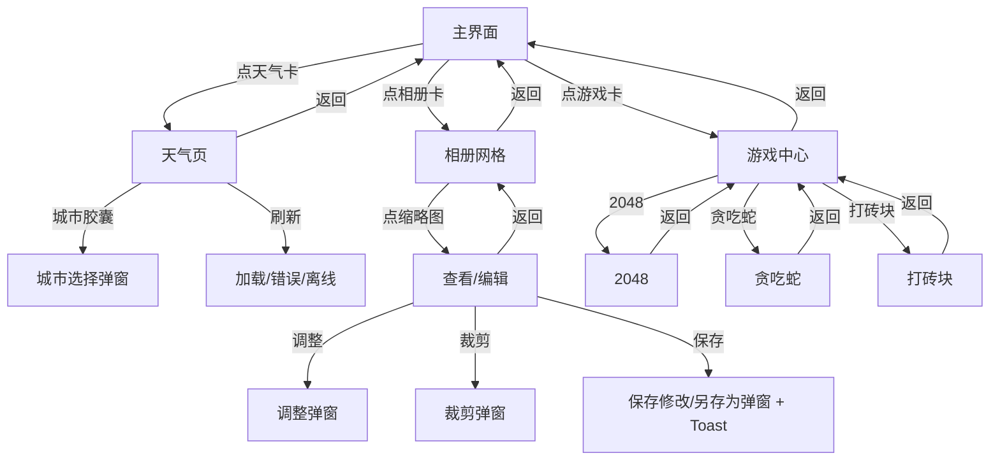

# UI 与交互设计

> 文档编号：04
> 状态：与实现同步（2026-11-27）
> 基准屏幕：1024×600，横屏，单点触摸
> 设计关键词：简约、留白、清晰、克制、触摸优先

## 1. 设计原则

1. **一屏一件事**：主界面只放三个应用入口；应用内只放当前任务需要的信息。
2. **返回永远可见**：所有二级/三级页面左上角固定“返回”，不依赖手势猜测。
3. **状态可感知**：加载、空、错误、离线、暂停、结算都有明确视觉状态，不让用户面对白屏。
4. **触摸优先**：最小点击区 56×56；主要按钮 64 高；卡片整块可点，不要求点小图标。
5. **少即是多**：不使用高饱和渐变堆叠、不使用多种阴影；用留白、圆角、层级色区分信息。
6. **颜色不是唯一信息**：状态同时用文字/图标表达，照顾色觉差异。
7. **中文为主，数字用无衬线**：中文用 Noto Sans SC，数字/英文用同一字体的拉丁字形或 Montserrat。

## 2. 设计令牌（Design Tokens）

### 2.1 颜色

| Token | 值 | 用途 |
|---|---|---|
| `UI_COLOR_BG` | `#171B1C` | 页面背景（深灰） |
| `UI_COLOR_SURFACE` | `#232829` | 卡片/弹窗（深灰） |
| `UI_COLOR_SURFACE_ALT` | `#2D3334` | 次级卡片/输入框 |
| `UI_COLOR_PRIMARY` | `#0E9F8C` | 主按钮、选中态、链接（青绿） |
| `UI_COLOR_PRIMARY_DARK` | `#0B7F70` | 主按钮按下（深青绿） |
| `UI_COLOR_PRIMARY_SOFT` | `#163A36` | 青绿深底（选中行/胶囊） |
| `UI_COLOR_ACCENT` | `#3FB8A3` | 次级强调（浅青绿） |
| `UI_COLOR_ACCENT_SOFT` | `#1A3A36` | 浅青绿深底 |
| `UI_COLOR_PURPLE` | `#5B8C87` | 相册强调（青灰） |
| `UI_COLOR_PURPLE_SOFT` | `#22302F` | 青灰深底 |
| `UI_COLOR_SUCCESS` | `#4FB286` | 成功/在线 |
| `UI_COLOR_WARNING` | `#D5A648` | 警告/离线（唯一暖色） |
| `UI_COLOR_DANGER` | `#E0635E` | 错误/失败/删除 |
| `UI_COLOR_TEXT` | `#E8EDEC` | 主文字（浅灰） |
| `UI_COLOR_TEXT_SECONDARY` | `#A9B4B2` | 次级文字 |
| `UI_COLOR_TEXT_MUTED` | `#7A8683` | 说明/占位 |

> 主题为**暗色灰 + 青绿**：深灰承担背景/卡片/文字，青绿承担主色与强调；
> 界面不再出现大面积白色。`*_SOFT` 令牌在暗色下表示“带主色的深底”。
> 应用卡片强调色：天气 `#0E9F8C`、相册 `#5B8C87`、小游戏 `#3FB8A3`、
> 2048 `#7C8F8C`、贪吃蛇 `#2FA37A`、打砖块 `#4E7F79`。
> 游戏棋盘/相册编辑画布仍为深灰（`UI_COLOR_BOARD_DARK` `#172022`），保证对比度。
| `UI_COLOR_LINE` | `#E4E9F2` | 分割线/描边 |
| `UI_COLOR_BOARD_DARK` | `#0F1626` | 游戏深色棋盘 |
| `UI_COLOR_WHITE` | `#FFFFFF` | 深色底上的文字 |

游戏棋盘可用色（2048 经典色，降低饱和度以统一风格）：

| 值 | 背景 | 文字 |
|---|---|---|
| 2 | `#EDE7DE` | `#5E687C` |
| 4 | `#E8DCCB` | `#5E687C` |
| 8 | `#F2B179` | `#FFFFFF` |
| 16 | `#F29A66` | `#FFFFFF` |
| 32 | `#F07C5A` | `#FFFFFF` |
| 64 | `#E85C3F` | `#FFFFFF` |
| 128 | `#E9C46A` | `#FFFFFF` |
| 256 | `#E5B94E` | `#FFFFFF` |
| 512 | `#E0AC38` | `#FFFFFF` |
| 1024 | `#D99A2B` | `#FFFFFF` |
| 2048 | `#C98A1F` | `#FFFFFF` |

### 2.2 字体与字号

| 名称 | 字号 | 用途 |
|---|---|---|
| `FONT_DISPLAY` | 48 | 天气大温度、首页时间 |
| `FONT_H1` | 34 | 首页标题 |
| `FONT_H2` | 28 | 页面标题、卡片标题 |
| `FONT_H3` | 26 | 分区标题 |
| `FONT_BODY` | 22 | 正文、按钮 |
| `FONT_SMALL` | 18 | 说明、次要信息 |
| `FONT_CAPTION` | 16 | 极小注释（仅非关键） |
| `FONT_NUMBER` | Montserrat 28/48 | 分数、温度数字 |

- 中文字体：`NotoSansSC-Board.ttf`（TinyTTF，18/22/26/34/48 各创建一个 `lv_font_t`）。
- 回退：字体文件缺失时用 `lv_font_simsun_16_cjk`；数字可用 `lv_font_montserrat_28/48`。
- 行高：TinyTTF 默认；卡片标题与正文之间留 8–12 px。

### 2.3 间距、圆角、阴影

| Token | 值 |
|---|---|
| 页面左右安全边距 | 32 |
| 内容顶部（状态栏/标题栏下） | 24 |
| 网格间距 | 24 |
| 卡片内边距 | 24 |
| 元素间距 | 8 / 12 / 16 / 24 |
| 卡片圆角 | 24 |
| 按钮圆角 | 14 |
| 小标签圆角 | 999（胶囊） |
| 卡片描边 | 1 px `#E9EDF5` |
| 卡片阴影 | y+8, blur 24, 8% 黑 |
| 弹窗遮罩 | `#0F1626` 40% |

### 2.4 动效

| 场景 | 时长 | 曲线 |
|---|---|---|
| 页面进入 | 180 ms | ease-out，透明度 0→255 + y 8→0 |
| 页面返回 | 150 ms | ease-in，透明度 255→0 |
| 按钮按下 | 80 ms | scale 1.0→0.98 |
| 弹窗 | 160 ms | 遮罩淡入 + 内容 scale 0.96→1 |
| Toast | 入 160 ms，停留 1800 ms，出 160 ms | 淡入淡出 |
| 2048 新块 | 120 ms | scale 0.8→1.0 |
| 游戏暂停 | 立即 | 遮罩 + 弹窗 |

### 2.5 图标

- 使用 LVGL 基础图形（圆、矩形、线、弧）绘制，不依赖位图：
  - 天气：太阳（圆 + 8 条射线）或云（3 个圆角矩形）。
  - 相册：两张错位圆角矩形 + 小圆（太阳）+ 折线（山）。
  - 游戏：2×2 圆角方块。
  - 返回：`‹` 字形或两条线组成的箭头。
  - 刷新：圆弧 + 箭头（用 `lv_arc` + 小三角）或文字“刷新”。
- 允许使用 LVGL 内置符号（`LV_SYMBOL_*`），但必须有中文文字兜底，避免字体缺符号。
- 所有图标按钮的触摸区 ≥ 56×56，视觉图形可小于触摸区。

## 3. 全局框架

### 3.1 页面结构

```text
┌──────────────────────────────────────────────────────────────┐
│ 状态栏 64px：时间 / 日期 / 网络或版本信息                      │
├──────────────────────────────────────────────────────────────┤
│ 标题栏 72px：返回 48×48 · 页面标题 · 右侧操作（刷新/保存/暂停）│
├──────────────────────────────────────────────────────────────┤
│                                                              │
│ 内容区：x=32..992，y=96..568（472 高）                         │
│                                                              │
└──────────────────────────────────────────────────────────────┘
```

- 首页没有“返回”，状态栏 64 + 品牌区 + 卡片区 + 底部提示。
- 二级页面标题栏固定 72，内容从 y=96 开始；底部操作栏（相册编辑器/贪吃蛇方向键）可占用 88–100。
- 弹窗覆盖全屏，遮罩拦截点击；弹窗最大宽度 560，圆角 24。

### 3.2 通用组件

| 组件 | 规格 | 说明 |
|---|---|---|
| `ui_topbar` | 1024×72，背景透明/页面色 | 左返回、居中标题、右操作 |
| `ui_card` | 白底、圆角 24、1px 描边、阴影 | 可点击时加按压反馈 |
| `ui_button_primary` | 高 56–64，圆角 14，主色底白字 | 主操作 |
| `ui_button_secondary` | 高 56–64，浅底深字/描边 | 次要操作 |
| `ui_icon_button` | 56×56，圆角 16 | 返回/刷新/暂停 |
| `ui_pill` | 高 36–40，圆角 999 | 城市、状态标签 |
| `ui_modal` | 最大 560×自动，遮罩 40% | 确认/结算/城市选择 |
| `ui_toast` | 底部居中，圆角 14，深色底白字 | 2 秒自动消失 |
| `ui_empty` | 居中图标 + 标题 + 说明 | 空相册/无网络 |
| `ui_loading` | 48px spinner + 文案 | 不遮挡返回按钮 |

## 4. 主界面（Home）

### 4.1 布局

```text
┌──────────────────────────────────────────────────────────────┐
│ 09:42   11月25日 星期三                     LVGL 9.2 · 1024×600 │ 64
├──────────────────────────────────────────────────────────────┤
│ 智慧生活                                                     │
│ 开发板应用中心                                               │
│                                                              │
│ ┌────────────┐  ┌────────────┐  ┌────────────┐              │
│ │  ☀/☁      │  │  ▣▣       │  │  ▦▦       │              │
│ │  天气      │  │  相册      │  │  小游戏    │              │
│ │  实时天气  │  │  浏览与编辑│  │  2048·蛇·砖│              │
│ │  与 7 日预报│  │  照片      │  │            │              │
│ │  查看 →    │  │  打开 →    │  │  进入 →    │              │
│ └────────────┘  └────────────┘  └────────────┘              │
│                                                              │
│ 点击卡片进入应用                                   v1.0.0     │
└──────────────────────────────────────────────────────────────┘
```

### 4.2 规格

- 状态栏：x=32，时间 28px 粗体；日期 18px 次级；右侧 16px 弱化。
- 品牌区：标题 34px，y=88；副标题 18px，y=136；左右 32。
- 卡片：y=200，高 300，宽 304，间距 24。
  - 图标区：左上 24,24，96×96 浅色圆角 24。
  - 标题：y=140，28px。
  - 副标题：y=184，18px，最多两行。
  - 底部动作：y=252，22px 主色“查看天气 →”。
- 卡片背景：天气 `#EAF1FF`，相册 `#F3ECFF`，游戏 `#FFF0E6`；白色内容层或浅色渐变。
- 底部：y=548，左侧 16px 提示，右侧版本号。
- 交互：整卡 `LV_OBJ_FLAG_CLICKABLE`；按下 scale 0.98；释放进入；进入时卡片轻微上浮/淡出。

### 4.3 空/异常

- 时间获取失败：显示 `--:--`，日期 `----年--月--日`。
- 资源缺失：卡片仍显示，进入应用后显示各自错误态。

### 4.4 新增应用与首页自适应

首页卡片**不是写死的三个**，而是由应用描述符自动生成（见 02/05）：

- 顶层应用：`parent_id == NULL && show_on_home == true`，按 `order` 排序。
- 卡片内容：`title`、`subtitle`、`icon`、`accent` 全部来自描述符；没有专属图标时用 `UI_ICON_GENERIC`。
- 新增应用只需在 `app/` 下新建文件夹并 `BOARD_APP_REGISTER`，首页自动出现卡片，无需改首页代码。

| 顶层应用数 | 布局 |
|---|---|
| 1–3 | 单行 3 列，卡片 304×300，垂直居中 |
| 4–6 | 3 列 × 2 行，卡片 304×240，内容可滚动 |
| >6 | 3 列，卡片 304×220，纵向滚动 |

- 卡片宽度按 `(960 - 2×24) / 3` 计算；不足 3 个时左对齐，不强制拉宽。
- 4 个及以上时，首页内容区启用纵向滚动；滚动条默认隐藏，滑动时显示。
- 卡片标题最多 1 行（超出省略），副标题最多 2 行；图标区 72×72（4+ 卡片时 64×64）。
- 新增应用若使用 `UI_ICON_GENERIC`，图标区显示该应用标题首字/简单几何图形，保证不空白。

游戏中心同理：`parent_id == "games"` 的游戏自动生成卡片；新增游戏不需要改游戏中心。

## 5. 天气页（Weather）

### 5.1 在线布局

```text
┌──────────────────────────────────────────────────────────────┐
│ ‹ 返回   天气                         [上海 ▾]   [↻ 刷新]    │ 72
├──────────────────────────────────────────────────────────────┤
│ ┌──────────────────────────┐  ┌──────────────────────────┐  │
│ │ 上海市            [在线] │  │ 未来 7 天                 │  │
│ │                          │  │                          │  │
│ │   0°       晴            │  │ 今天  ☀  晴     -2° / 7° │  │
│ │                          │  │ 周四  ☁  多云    1° / 12°│  │
│ │ 最高 7° · 最低 -2°       │  │ 周五  ☁  多云    4° / 11°│  │
│ │                          │  │ 周六  ☀  晴      1° / 10°│  │
│ │ 湿度 43%   东南风 1级    │  │ 周日  ☁  多云    0° / 9° │  │
│ │ 空气质量 优 · AQI 53     │  │ 周一  ☁  多云    0° / 11°│  │
│ │                          │  │ 周二  ☁  多云    1° / 12°│  │
│ │ 更新于 09:42             │  │                          │  │
│ └──────────────────────────┘  └──────────────────────────┘  │
└──────────────────────────────────────────────────────────────┘
```

### 5.2 规格

- 左侧主卡：x=32，y=96，440×472，蓝灰渐变/浅蓝底，圆角 24。
  - 城市 28px，右上角状态胶囊（在线/离线/演示）。
  - 温度：Montserrat 48px（受当前 LVGL 内置字号限制；设计图放大显示），单位 `°` 28px 上标；条件 28px。
  - 最高/最低 20px。
  - 指标行：湿度、风向风力、空气质量；两列布局，标签 16px 次要，值 22px。
  - 更新时间 16px 弱化；刷新时显示 spinner。
- 右侧预报卡：x=496，y=96，496×472，白底。
  - 标题“未来 7 天”26px，y=24。
  - 7 行，每行 56px：星期 18px，天气图标 28×28，天气文字 18px，温度条/高低温右对齐 18px。
  - 今天行浅蓝底、左侧 4px 主色条。
  - 行间 1px 分割线 `#EEF2F8`。
- 城市选择：点城市胶囊打开弹窗，3×3 城市按钮（北京/上海/广州/深圳/成都/杭州/武汉/西安），当前项主色描边；确认后关闭并刷新。
- 刷新按钮：56×56，旋转动画 600ms/圈；请求中禁用。

### 5.3 状态

| 状态 | 视觉 | 操作 |
|---|---|---|
| 首次加载（无缓存） | 左卡 skeleton/ spinner + “正在获取天气…” | 返回可用 |
| 有缓存、后台刷新 | 正常数据 + 右上小 spinner | 可返回 |
| 在线成功 | 数据 + 绿色“在线” | 刷新/切换城市 |
| 离线有缓存 | 数据 + 橙色“离线数据” + “上次更新 …” | 重试 |
| 离线无缓存 | 空态插画 + “无法获取天气” + 原因 + 重试 | 重试/返回 |
| 演示数据 | 数据 + 灰色“演示数据” | 重试 |

### 5.4 错误文案

- 网络：`网络不可用，请检查开发板网络连接`
- 超时：`请求超时，请稍后重试`
- 解析：`天气数据格式异常`
- 通用：`暂时无法获取天气`

## 6. 相册（Gallery）

### 6.1 网格

```text
┌──────────────────────────────────────────────────────────────┐
│ ‹ 返回   相册                    8 张照片          [刷新]     │ 72
├──────────────────────────────────────────────────────────────┤
│ ┌──────────┐  ┌──────────┐  ┌──────────┐                   │
│ │  [缩略图] │  │  [缩略图] │  │  [缩略图] │                   │
│ │ sample-01 │  │ sample-02 │  │ sample-03 │                   │
│ └──────────┘  └──────────┘  └──────────┘                   │
│ ┌──────────┐  ┌──────────┐  ┌──────────┐                   │
│ │  [缩略图] │  │  [缩略图] │  │  [缩略图] │                   │
│ └──────────┘  └──────────┘  └──────────┘                   │
│  可上下滚动 …                                                │
└──────────────────────────────────────────────────────────────┘
```

- 内容 960 宽，3 列，卡片 304×220，间距 24；两行 + 滚动。
- 缩略图 280×160（圆角 16，`LV_IMAGE` 等比裁剪/留白）；文件名 16px，省略号。
- 顶部右侧显示“N 张照片”，刷新按钮重新扫描。
- 点击卡片：按压缩放，进入查看器；加载大图时显示 spinner。
- 空态：居中图标 + “还没有照片” + “把图片放到 assets/photos/ 后点击刷新”。

### 6.2 查看器 / 编辑器

```text
┌──────────────────────────────────────────────────────────────┐
│ ‹ 返回   sample-03.png                         [保存] [删除] │ 72
├──────────────────────────────────────────────────────────────┤
│ ┌──────────────────────────────────────────────────────────┐ │
│ │                                                          │ │
│ │                  [图片等比居中显示]                       │ │ 400
│ │                                                          │ │
│ └──────────────────────────────────────────────────────────┘ │
│  [左旋] [右旋] [翻转] [灰度] [调整] [裁剪] [撤销] [重置]      │ 88
└──────────────────────────────────────────────────────────────┘
```

- 图片区背景 `#10141C`，图片居中，最大 976×400；图片外留 12px。
- 底部工具栏 8 个按钮，104×72，图标 + 16px 文字；禁用态 40% 透明度。
- 顶部“保存”主按钮：56 高，点击后弹出“保存修改 / 另存为”选择；已保存副本可覆盖，原图不覆盖。
- 编辑页右上角“保存”旁边始终有“删除”；删除前二次确认，删除后不可恢复。
- 编辑操作立即作用于编辑缓冲；预览在 100–200 ms 内刷新；大图操作时显示轻量遮罩（不阻塞返回？保存/裁剪确认时阻塞）。
- 撤销栈 4 步；无历史时“撤销”禁用；“重置”总是可用（回到加载态）。
- 保存文件名：`<原文件名>_edited_20261125_094215.png`；保存目录为**原图所在目录**；
  Toast 只显示文件名。`保存修改`在已保存副本上原地覆盖，对 `assets/photos`
  原图则生成同目录副本，避免破坏示例图。

### 6.3 调整弹窗

```text
┌──────────────────────────────┐
│ 调整亮度 / 对比度             │
│ 亮度   ───────●──────   +12  │
│ 对比度 ────●─────────   -05  │
│ [取消]              [应用]   │
└──────────────────────────────┘
```

- 两个滑杆，范围 -100..100；实时预览可做 1/2 降采样，释放后全分辨率应用。
- 应用入撤销栈；取消恢复打开弹窗前状态。

### 6.4 裁剪弹窗

```text
┌──────────────────────────────┐
│ 裁剪                          │
│ 比例：[1:1] [4:3] [16:9] [自由]│
│ 位置：  ↖  ↑  ↗              │
│         ←  ●  →              │
│         ↙  ↓  ↘              │
│ 预览： [裁剪框叠加图]          │
│ [取消]              [裁剪]   │
└──────────────────────────────┘
```

- 比例决定裁剪框长宽；九宫格定位决定裁剪框在原图中的位置（居中/靠边）。
- “自由”当前实现为取原图 80% 居中裁剪；后续如需要可加宽/高滑杆，但需同步更新本节。
- 裁剪后尺寸至少 64×64；超出边界自动夹紧。
- 确认后入撤销栈。

## 7. 小游戏中心

卡片宽度**按游戏数量自适应**：4 款用 222px（4×222 + 3×24 = 960，正好一行放得下），
少于 4 款用 304px。宽度变化时预览区高度、标题/副标题/最高分/按钮位置按比例重算，
避免第 4 张卡片被挤出屏幕。当前 4 款：联网围棋 / 2048 / 贪吃蛇 / 打砖块。

```text
┌──────────────────────────────────────────────────────────────┐
│ ‹ 返回   小游戏                                  3 款游戏     │ 72
├──────────────────────────────────────────────────────────────┤
│ ┌────────────┐  ┌────────────┐  ┌────────────┐              │
│ │  2048      │  │  贪吃蛇    │  │  打砖块    │              │
│ │  [4×4 预览]│  │  [蛇形预览]│  │  [砖块预览]│              │
│ │  合并数字  │  │  越长越快  │  │  拖动挡板  │              │
│ │  最高 4096 │  │  最高 180  │  │  最高 320  │              │
│ │  [开始]    │  │  [开始]    │  │  [开始]    │              │
│ └────────────┘  └────────────┘  └────────────┘              │
│  游戏规则核心来自 Little World Arcade（MIT）                 │
└──────────────────────────────────────────────────────────────┘
```

- 三张 304×360 卡片，y=140；预览区 256×140，用 LVGL 图形绘制（非截图）。
- 卡片底部“开始”主按钮；最高分从 storage 读取。
- 页脚注明开源来源，满足许可证可见性。

## 8. 2048

```text
┌──────────────────────────────────────────────────────────────┐
│ ‹ 返回   2048                          [暂停]       [新游戏]  │ 72
├──────────────────────────────────────────────────────────────┤
│ ┌─────────┐  ┌──────────────────────────┐  ┌─────────┐      │
│ │ 分数    │  │                          │  │ 最高分  │      │
│ │ 1024    │  │      4 × 4 棋盘           │  │ 4096    │      │
│ │         │  │      480 × 480            │  │         │      │
│ │ 步数 86 │  │                          │  │ 最大 512│      │
│ │         │  │                          │  │         │      │
│ │  ↑      │  │                          │  │ 提示：  │      │
│ │ ← ● →  │  │                          │  │ 滑动或  │      │
│ │  ↓      │  │                          │  │ 方向键  │      │
│ │ [新游戏]│  │                          │  │         │      │
│ └─────────┘  └──────────────────────────┘  └─────────┘      │
└──────────────────────────────────────────────────────────────┘
```

- 棋盘 x=272，y=88，480×480；4×4，内边距 12，格间距 12，格 105。
- 左侧 216 宽：分数/步数卡片；四向按钮 56×56；新游戏按钮。
- 右侧 216 宽：最高分、最大数字、操作提示。
- 格子：圆角 16，数字 28/34px（4 位数用 28，5 位用 24）；颜色见令牌表。
- 手势：在棋盘上滑动，阈值 24px；一次滑动只触发一次；动画 80ms 后刷新。
- 胜利：达到 2048 弹窗“达成 2048！”[继续挑战] [重新开始]；继续后不再重复弹窗。
- 失败：无空格且无可合并，弹窗“棋局结束”显示分数/最高分 [再来一局]。
- 暂停：弹窗“已暂停” [继续] [重新开始] [返回游戏中心]。

## 9. 贪吃蛇

```text
┌──────────────────────────────────────────────────────────────┐
│ ‹ 返回   贪吃蛇        得分 120 · 最高 180 · 长度 12  [暂停]  │ 72
├──────────────────────────────────────────────────────────────┤
│        ┌──────────────────────────────────────────┐          │
│        │                                          │          │
│        │          28 × 13 深色棋盘                │  390     │
│        │          840 × 390                       │          │
│        │                                          │          │
│        └──────────────────────────────────────────┘          │
│   [↑]        [暂停] [重开]              [←] [↓] [→]          │ 88
└──────────────────────────────────────────────────────────────┘
```

- 棋盘 x=92，y=92，840×390；格子 30×30，圆角 6；深色底 `#0F1626`，网格线 `#1C2740`。
- 蛇身：绿色 `#2FBF71`，头部深绿 `#1F9D5A`，眼睛白点；食物红橙圆点 + 高光。
- 方向控制：底部左侧/右侧方向键 64×64；支持在棋盘上滑动；禁止 180° 反向（核心已处理）。
- 顶部 HUD 在标题栏内：得分、最高、长度；空间不足时用两行小字。
- 暂停/重开按钮；暂停时棋盘加半透明遮罩 + 弹窗。
- 游戏结束：弹窗“撞到了”/“游戏结束” + 得分 + [再来一局] [返回]。
- 速度：核心 `arcade_snake_step_ms()` 返回 220→90ms；UI 每步重设定时器周期。

## 10. 打砖块

```text
┌──────────────────────────────────────────────────────────────┐
│ ‹ 返回   打砖块      得分 240 · 最高 320 · ♥♥♥       [暂停]  │ 72
├──────────────────────────────────────────────────────────────┤
│ ┌──────────────────────────────────────────────────────────┐ │
│ │  ██████████████████████████████████████████████████████  │ │
│ │  ██████████████████████████████████████████████████████  │ │
│ │  ... 6 行 × 10 列砖块 ...                                 │ │ 468
│ │                                                          │ │
│ │                        ●                                 │ │
│ │                  ▬▬▬▬▬▬▬▬▬▬▬                            │ │
│ └──────────────────────────────────────────────────────────┘ │
│  拖动挡板 · 点击发球                              [重开]      │
└──────────────────────────────────────────────────────────────┘
```

- 游戏区 1008×468，x=8，y=88；圆角 16；深色底。
- 砖块 10×6，92×30，间距 8，起始 8,24；按行着色（蓝/青/绿/黄/橙/红）。
- 挡板 150×18，距底 40；球半径 7。
- HUD 放在标题栏：得分、最高、生命（红心/圆点）；右侧暂停。
- 操作：在游戏区拖动移动挡板（映射到 0..1008 固定点）；点击/轻触发球；空格（若接键盘）也可发球。
- 状态：READY 显示“点击发球”提示；RUNNING 正常；PAUSED 遮罩；WON/LOST 结算弹窗。
- 帧率：16ms 定时器；只更新球/挡板位置，砖块状态变化时刷新可见性。

## 10.1 联网围棋（Games → 联网围棋）

- 入口：小游戏中心第 4 张卡片（`parent_id = "games"`，不在首页单独出现）。
- 三种视图：
  - **未登录**：提示 + 「去账户登录」；
  - **大厅**：9/13/19 路选择（选中项高亮）、好友列表（在线可邀请、离线置灰）、「邀请」；
  - **对局**：左侧 512×512 棋盘（木色底 + 网格 + 棋子 + 最后一手描边），
    右侧信息面板（对手/路数/执子颜色/双方提子/轮次/结果）+「停一手」「认输」「退出对局」。
- 棋盘用 `lv_line` 画 19+19 条线、预建 361 个圆形 `lv_obj` 当棋子（按局面显隐），
  点击棋盘用坐标反算交叉点，不依赖图片资源。

## 10.2 聊天室（首页卡片）

- 左 192px：会话列表（「群聊 · UDP」固定第一项 + 好友，在线圆点、未读「新」标记）。
- 中 300px：消息区（历史 + 实时，来自本地聊天记录）+ 输入框 + 「发送」。
- 右 504px：复用 `ui_ime` 中文输入法键盘（拼音候选条、中/英、送出）。
- 顶栏：「聊天室 · 用户名」「在线 n/m」「加好友」、返回。

## 10.3 系统账户（首页顶栏账号胶囊进入）

- 首页右上角胶囊：未登录显示「未登录」+ 灰点；已登录显示用户名 + 绿点，每秒刷新。
- **未登录**：服务器地址（默认空，占位给示例）、用户名、密码 + 「登录」「注册」，底部英文键盘。
- **已登录**：账号卡片（用户名 + 说明 + 退出登录）、好友列表（在线状态、删除）、「加好友」。

## 10.4 AI 聊天（首页卡片）

- 布局（1024×600）：
  - 顶栏 72px：「AI 聊天」+「清空」+ 状态标签（「在线大模型」/「离线助手」）；
  - 左半屏 512px：消息列表（气泡，用户右对齐主色、助手左对齐带 34px 圆形头像），
    底部输入框 + 「发送」；
  - 右半屏 504px：`ui_ime` 键盘（候选条 + 26 键 + 中/英 + 常用语 + 送出）。
- 状态：
  - 空态：欢迎语 +（配置了大模型时）「已连接大模型，直接问我就好」；
  - 思考中：助手气泡显示三个点动画；
  - 失败：气泡内容为离线助手回复，顶栏状态变「离线助手」。
- 交互：点候选字把汉字插入输入框；点「送出」/「发送」发一条；「清空」清空对话
  （同时让在途回复失效，避免清空后又冒出一条）。
- 长文本：气泡宽度 100%，自动换行；列表滚动到底。

## 11. 交互流程



### 11.1 返回规则

- 标题栏“‹ 返回”始终在最左侧，56×56 触摸区。
- 弹窗打开时，返回按钮先关闭弹窗（或按弹窗“取消”），不直接退出页面。
- 游戏暂停弹窗中的“返回游戏中心”才退出；直接点标题栏返回时先暂停并确认（防止误触丢进度）。
- 保存弹窗确认后写入文件并显示 Toast；保留当前编辑页，本次会话内不强制返回。

### 11.2 防误触

- 主按钮高度 ≥ 56；相邻按钮间距 ≥ 12。
- 破坏性操作（重置/放弃编辑）需二次确认。
- 游戏重开在游戏进行中需确认；结算页可直接重开。
- 连续点击进入同一页面时，导航器忽略第二次。

## 12. 无障碍与可读性

- 正文对比度 ≥ 4.5:1（浅灰 `#E8EDEC` 对 `#171B1C` ≈ 13:1；次级 `#A9B4B2` ≈ 8:1）。
- 关键信息不只靠颜色：在线/离线同时有文字；生命值同时有数字/心形。
- 字号：正文 ≥ 18px；关键数字 ≥ 28px；避免 14px 以下中文。
- 触摸目标：≥ 56×56；卡片整块可点。
- 动画可关：预留 `BOARD_APP_REDUCE_MOTION=1`，关闭转场/缩放（实现阶段）。
- 文案：短句、动词开头；错误信息说明“发生了什么 + 怎么办”。

## 13. 设计验收清单

- [ ] 1024×600 下所有页面无溢出、无遮挡、无横向滚动（网格纵向滚动除外）。
- [ ] 三个主卡片在 1 米外可辨认；标题/副标题层级清楚。
- [ ] 每个页面左上角返回可点，连续点击 10 次不崩溃。
- [ ] 加载/空/错误/离线状态均有文案和下一步操作。
- [ ] 触摸目标 ≥ 56×56；按钮按下有反馈。
- [ ] 中文字体无方框（至少静态文案 + 天气常用字）。
- [ ] 游戏 HUD 不遮挡棋盘；暂停/结算弹窗可操作。
- [ ] 颜色使用令牌，无散落魔法值（实现阶段检查）。
- [ ] 与 `docs/design/mockup-*.png` 的布局一致；差异需在评审中说明。

## 14. 设计图

见 `docs/design/`：

| 文件 | 内容 |
|---|---|
| `mockup-home.png` | 主界面 |
| `mockup-weather.png` | 天气页 |
| `mockup-gallery.png` | 相册网格 |
| `mockup-editor.png` | 图片编辑器 |
| `mockup-games.png` | 游戏中心 |

> 设计图是评审基线，不是逐像素切图；实现时以本文档的尺寸/令牌为准。若设计图与文档冲突，以文档为准并更新图。

## 14.1 真实渲染截图

`docs/screenshots/` 是主机预览程序用真实 LVGL 9.2 渲染的截图（非设计效果图），用于确认实现与设计的一致性。索引见 `docs/screenshots/README.md`。当前已覆盖首页、天气/城市弹窗、相册网格/编辑器/调整/裁剪、游戏中心、2048/暂停、贪吃蛇、打砖块/发球。
