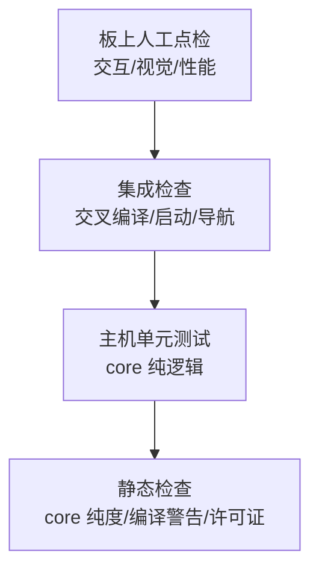

# 测试与验收

> 文档编号：07
> 状态：与实现同步（2026-11-27）
> 原则：核心逻辑用主机自动化测试保证；UI 用板上点检清单保证；不能用“编译通过”代替“功能通过”。

## 1. 测试金字塔



| 层级 | 运行环境 | 覆盖 | 频率 |
|---|---|---|---|
| 静态检查 | 任意 | core 不含 LVGL、无 TODO 泄漏、许可证文件 | 每次提交 |
| 主机单元测试 | WSL x86_64 | 游戏规则、天气解析、图片操作、存储/队列 | 每次提交 |
| 交叉编译 | WSL aarch64 | 全工程链接、目标架构、资源路径 | 每次提交/每日 |
| 板上点检 | 开发板 | 触摸、显示、导航、天气、相册、游戏、稳定性 | 每个里程碑 |

## 2. 主机测试

### 2.1 构建与运行

```bash
cd /home/jingzhe/lvgl/lv_port_linux-release-v9.2
cmake -S board_app/tests/host -B build_host_tests -DCMAKE_BUILD_TYPE=Debug
cmake --build build_host_tests -j8
ctest --test-dir build_host_tests --output-on-failure
```

建议同时跑 ASan/UBSan：

```bash
cmake -S board_app/tests/host -B build_host_tests_asan \
  -DCMAKE_BUILD_TYPE=Debug \
  -DCMAKE_C_FLAGS="-fsanitize=address,undefined -fno-omit-frame-pointer -g"
cmake --build build_host_tests_asan -j8
ctest --test-dir build_host_tests_asan --output-on-failure
```

### 2.2 测试清单

#### 游戏核心（第三方 `arcade_core`）

| 用例 | 输入/步骤 | 期望 |
|---|---|---|
| G2048-init | `arcade_2048_init` | 恰好 2 个非零格；值为 2/4；分数 0；未结束 |
| G2048-merge | 构造 `[2,2,0,0]` 行，向左 | 合并为 4；得分 +4；`merged_mask` 标记结果格；生成一个新块 |
| G2048-no-double-merge | `[2,2,2,2]` 向左 | 结果 `[4,4,0,0]`，不是 8 |
| G2048-no-move | 满盘无可合并，向左 | `moved=0`；`over=1` |
| G2048-win | 构造 1024+1024 合并 | `won=1`；最大块 2048 |
| G2048-rng | 同 seed 两次 init | 棋盘一致（确定性） |
| Snake-init | `arcade_snake_init` | 长度 3；头在中点；方向右；食物不在蛇身 |
| Snake-turn | 向右时请求左 | 拒绝（180°） |
| Snake-turn-buffer | 连续请求上、左 | 最多缓存 2 个；逐步生效 |
| Snake-eat | 把食物放到头前方，step | 长度 +1；分数 +10；事件含 ATE；新食物不在蛇身 |
| Snake-die-wall | 头在边界，向外 step | `alive=0`；事件 DIED |
| Snake-die-self | 构造自撞 | `alive=0`；事件 DIED |
| Snake-speed | 吃 0/10/30 个食物 | 步进 220 → 160 → 90（clamp） |
| Breakout-init | init | 60 砖；3 命；READY；球在挡板中心上方 |
| Breakout-launch | launch | RUNNING；vy < 0；vx 非 0 |
| Breakout-paddle-clamp | move_paddle 到 -100/2000 | 挡板不越界；READY 时球跟着挡板 |
| Breakout-brick | 球对准砖块 tick | 砖数 -1；分数 +10；速度反向 |
| Breakout-lose | 球落底 3 次 | 前两次 READY，第三次 OVER |
| Breakout-win | 清空所有砖 | WON；球速 0 |

#### 天气解析

| 用例 | 输入 | 期望 |
|---|---|---|
| W-PARSE-OK | 内嵌北京 JSON 样本 | 城市北京；温度 -6；湿度 59；3 天；字段完整 |
| W-PARSE-HIGH-LOW | `"高温 9℃"` / `"低温 -4℃"` | 9 / -4 |
| W-PARSE-MISSING | 缺 `data.forecast` | `BOARD_ERR_PARSE` |
| W-PARSE-PARTIAL | 缺 AQI/PM25 | 默认值；不崩溃 |
| W-PARSE-BAD | 空串/非 JSON | `BOARD_ERR_PARSE` |
| W-PARSE-MANY | 15 天 | 只取前 7 天 |
| W-PARSE-NEGATIVE | `-10℃` | -10 |

#### 围棋规则（移植自 weiqi.js）

| 用例 | 步骤 | 期望 |
|---|---|---|
| WQ-INIT | `weiqi_init(9/13/19)` | size 正确、黑先行；10 路返回 -1 |
| WQ-PLAY | 空盘落子 | 成功；轮次切换；同点再落失败 |
| WQ-CAPTURE | 三面包围后落最后一气 | 敌子被提；`captured[黑]=1` |
| WQ-SUICIDE | 自己无气的落点 | 返回 `WEIQI_ERR_SUICIDE`；棋盘不变 |
| WQ-SUPERKO | 回到历史局面 | 返回 `WEIQI_ERR_KO` |
| WQ-PASS-OVER | 连续两次 pass | `over=1` 且 `result` 非空；之后落子失败 |
| WQ-RESIGN | 黑认输 | `result` 含“白胜” |
| WQ-AREA | 3 黑围 1 空 | 黑 4 子、白 1 子 |
| WQ-KOMI | 同上 + 贴目 | 黑 4.0 / 白 4.5（白胜） |
| WQ-SERIALIZE | `board_string` → `board_parse` | 13×13 文本往返一致 |
| WQ-SETSTATE | 复刻服务器局面 | turn/captured/last/over 一致 |

#### 通信与聊天记录

| 用例 | 步骤 | 期望 |
|---|---|---|
| C-FRAME | `comm_frame_pack/peek` | 长度前缀正确；半包返回 PARTIAL；超长返回 BAD |
| C-NAME | 用户名校验 | 空/超长/含空格或冒号 → 拒绝 |
| C-HISTORY-APPEND | 追加 3 条 | 文件 3 行；字段完整 |
| C-HISTORY-TRIM | 追加 205 条 | 只保留最近 200 条 |
| C-HISTORY-LOAD | 读回 | 顺序从旧到新；超过 max 只取最后 max 条 |
| C-HISTORY-BADPEER | 非法会话名 | 返回 -EINVAL，不创建文件 |

> 通信协议的端到端（登录/好友/私聊/离线补发/UDP 群聊）由
> `server/tools/smoke_test.sh` 验证；围棋对局由 `server/tools/weiqi_smoke.sh` 验证。

#### HTTP 客户端

`http_client` 的完整路径（DNS、连接、Content-Length/chunked、重定向、超时）由主机预览
访问真实接口和板上点检验证。当前主机单元测试不启动本地 HTTP 服务；如需自动化，可后续
在 `tests/host` 加一个监听 `127.0.0.1` 的 socket 夹具，覆盖 200/chunked/301/超时。

#### 图片操作

| 用例 | 步骤 | 期望 |
|---|---|---|
| I-LOAD-PNG | 加载示例 PNG | w/h 正确；RGBA 长度 = w*h*4 |
| I-LOAD-BAD | 文本文件改名 .png | 返回 NULL；不崩溃 |
| I-ROTATE | 3×2 旋转 90° | 2×3；像素位置正确 |
| I-ROTATE-360 | 旋转 4 次 | 与原图逐像素一致 |
| I-FLIP-H/V | 翻转两次 | 与原图一致 |
| I-GRAY | 纯红 (255,0,0) | (76,76,76)（0.299*255≈76） |
| I-BRIGHT | +100 | 所有通道 +255（clamp） |
| I-CONTRAST | 0 | 不变 |
| I-CROP | 从 4×4 裁剪 2×2 | 尺寸/像素正确；越界返回错误 |
| I-SAVE-LOAD | 保存 PNG 再加载 | 尺寸一致；关键像素误差 0 |
| I-RESIZE-FIT | 2000×1000 缩到 1280×800 | 1280×640；不放大 |
| I-BGRA | 红 (255,0,0,255) | 字节 B=0,G=0,R=255,A=255 |

#### 存储

| 用例 | 步骤 | 期望 |
|---|---|---|
| S-INIT | 临时目录 | 文件不存在时用默认值；不报错 |
| S-SET-GET | 字符串/整数 | 读回一致；特殊字符 `=` 保留 |
| S-SAVE-RELOAD | set → save → shutdown → init | 值保留 |
| S-CORRUPT | 文件含坏行 | 跳过坏行；其余可读 |
| S-ATOMIC | 写入时模拟中断 | 旧文件仍完整（可用备份文件验证） |
| S-LONG | 超长 key/value | 返回 `BOARD_ERR_INVALID`；不越界 |

#### 路径与时间

| 用例 | 步骤 | 期望 |
|---|---|---|
| P-ROOT-ENV | 设置 `BOARD_APP_ROOT` | 所有路径基于该目录 |
| P-FALLBACK | 无 env，cwd 有 assets | 使用 cwd |
| P-DATA-OVERRIDE | `BOARD_APP_DATA_DIR` | data 路径覆盖 |
| T-FORMAT | 固定 time_t | `HH:MM`、`M月D日 星期X` 正确 |
| T-WEEKDAY | 周日..周六 | 中文星期正确 |

### 2.3 主机 UI 预览

除核心单测外，`board_app/tests/preview/` 提供一个 headless LVGL 预览：真实构建 `board_ui`，把 1024×600 画面渲染到内存 buffer 并导出 PNG。当前会执行：

- 首页 → 天气（等待在线数据）→ 城市弹窗 → 选择城市；
- 相册 → 打开第一张 → 右旋/灰度/撤销/调整/裁剪/保存；
- 游戏中心 → 2048（方向键移动/暂停）→ 贪吃蛇 → 打砖块（发球）。

```bash
cd /home/jingzhe/lvgl/lv_port_linux-release-v9.2
cmake -S board_app/tests/preview -B build_preview -DCMAKE_BUILD_TYPE=Debug
cmake --build build_preview -j8
BOARD_APP_ROOT=$PWD/board_app \
PREVIEW_OUT=$PWD/board_app/docs/screenshots \
./build_preview/board_preview
```

通过标准：进程退出码 0；`docs/screenshots/` 生成全部截图；日志无 `Error`/断言；字体加载日志为 `loaded CJK font`。

### 2.4 通过标准

- `ctest` 0 失败；ASan/UBSan 无报错。
- 覆盖率（可选）：core 行覆盖 ≥ 70%，游戏核心 ≥ 80%。
- 新增功能必须新增对应用例；修复 bug 必须先加回归用例。

## 3. 静态检查

```bash
# 1) core 纯度：不得出现 lvgl.h / lv_ 调用
python3 board_app/tools/check_core_purity.py

# 2) 编译警告（交叉编译时）
cmake --build build_board_app -j8 2>&1 | tee build.log
grep -iE "warning:|error:" build.log || true
```

预期：无新增 warning；`-Werror` 在稳定后开启。

**许可证检查**：

- `third_party/littleworld_arcade/LICENSE`、`UPSTREAM.md` 存在。
- `third_party/cjson/LICENSE`、`third_party/stb/LICENSE` 存在。
- `assets/fonts/OFL.txt` 存在；字体来源记录。
- 无 GPL 代码进入 `board_app/`（`grep -R "GNU General Public License" board_app/` 只应出现在说明/排除项）。

## 4. 交叉编译检查

```bash
cd /home/jingzhe/lvgl/lv_port_linux-release-v9.2
rm -rf build_board_app
cmake -S . -B build_board_app -DCMAKE_BUILD_TYPE=Release
cmake --build build_board_app -j8

file bin/main
readelf -h bin/main | grep -E "Class|Machine|Type"
```

通过标准：

- `Class: ELF64`、`Machine: AArch64`。
- 无 `undefined reference`。
- 产物大小合理（不含调试符号时通常 1–4 MB，视 LVGL 配置）。
- `bin/main` 与 `assets/` 能一起部署。

## 5. 板上点检清单

> 每个里程碑至少跑一遍；v1.0 验收全跑。建议录屏/拍照存档。

### 5.1 启动与主界面

- [ ] 上电/启动后 3 秒内出现主界面，无黑屏/花屏。
- [ ] 时间与系统时间一致；等待 1 分钟，分钟更新。
- [ ] 日期/星期正确（跨天可改系统时间测试）。
- [ ] 5 张卡片（聊天室 / AI 聊天 / 天气 / 相册 / 小游戏）标题、副标题、图标完整；无中文方框。
- [ ] 点击卡片有按下反馈；点击边缘也能进入。
- [ ] 连续快速点击同一卡片不会打开两次/崩溃。

### 5.2 导航

- [ ] 天气 → 返回 → 主界面。
- [ ] 相册 → 查看器 → 返回 → 相册 → 返回 → 主界面。
- [ ] 游戏中心 → 2048 → 返回 → 游戏中心 → 返回 → 主界面。
- [ ] 弹窗打开时点返回：先关闭弹窗，不退出页面。
- [ ] 连续进出各应用（含聊天室、围棋、账户）各 20 次：无崩溃、无明显卡顿、对象数不持续增长。

### 5.3 天气

- [ ] 在线：显示城市、温度、天气、最高/最低、湿度、风、AQI、更新时间。
- [ ] 7 天预报 7 行，顺序/星期正确。
- [ ] 刷新：出现加载态，按钮禁用；成功后数据更新。
- [ ] 切换城市：弹窗可选 8 个城市；选择后城市/数据变化；重启后保留。
- [ ] 断网刷新：6 秒内显示错误或离线缓存；有“离线数据/上次更新”标识。
- [ ] 缓存 1 小时：把缓存 mtime 改到 2 小时前，重启/进入天气必须重新 GET 并更新时间；不得直接显示过期数据。
- [ ] 无缓存断网：显示错误态 + 重试，不白屏。
- [ ] 刷新过程中返回主界面：不崩溃；再次进入正常。
- [ ] 连续刷新 10 次：无泄漏/崩溃。

### 5.4 相册

- [ ] 网格显示示例图；数量正确；缩略图不变形。
- [ ] 滚动流畅；点击进入大图；大图不变形/不超出屏幕。
- [ ] 左旋/右旋：方向正确；连续 4 次回原方向。
- [ ] 水平/垂直翻转：方向正确。
- [ ] 灰度：颜色变灰；撤销恢复。
- [ ] 亮度/对比度：滑杆预览；应用/取消正确。
- [ ] 裁剪：1:1/4:3/16:9/自由 + 九宫格；结果正确；取消不改。
- [ ] 撤销 4 次/重置：状态正确；按钮禁用态正确。
- [ ] 保存：点“保存”弹出“保存修改/另存为”；文件生成在原图所在目录，文件名带 `_edited_时间`；Toast 显示文件名；原图未被修改。
- [ ] 保存后返回网格：新图出现（或刷新后出现）。
- [ ] 编辑页“保存”旁边的“删除”：任意图片二次确认后可删除；删除后网格刷新。
- [ ] 空目录：空态文案/路径提示；不崩溃。
- [ ] 损坏图片：跳过/错误提示；不影响其他图。
- [ ] 连续编辑/保存 10 次：无 OOM/崩溃。

### 5.5 游戏

**通用**

- [ ] 游戏中心 4 张卡片（含联网围棋）一行显示、最高分正确。
- [ ] 进入/退出游戏各 10 次：无崩溃、定时器停止（CPU 不持续占用）。
- [ ] 暂停/继续/重开/返回均可用；暂停时画面静止。
- [ ] 结算弹窗显示得分/最高分；最高分更新并持久化。
- [ ] 触摸操作跟手；按钮不遮挡棋盘。

**2048**

- [ ] 四方向滑动都能合并；一次滑动只走一步。
- [ ] `[2,2,2,2]` 合并为 `[4,4]`（不是 8）。
- [ ] 得分累加正确；最高分更新。
- [ ] 达到 2048 弹胜利；继续后可继续玩；不再重复弹窗。
- [ ] 满盘无可移动弹失败；重开清空。
- [ ] 快速连续滑动不产生重复新块/崩溃。

**贪吃蛇**

- [ ] 方向键/滑动转向；不能 180° 反向。
- [ ] 吃食物长度/分数增加；食物不生成在蛇身。
- [ ] 撞墙/撞自己结束；结算正确。
- [ ] 速度随长度增加（220→90ms）；不出现“穿墙”。
- [ ] 暂停/继续后节奏正常；重开长度/分数复位。

**打砖块**

- [ ] 拖动挡板跟手；挡板不越界。
- [ ] 点击发球；球碰到墙/挡板/砖块反弹合理。
- [ ] 砖块消除、分数增加；清屏胜利。
- [ ] 掉球扣命；3 命耗尽失败；READY 时球跟随挡板。
- [ ] 帧率稳定（目测无卡顿）；暂停/继续正常。
- [ ] 连续玩 3 局无崩溃/明显泄漏。

### 5.6 显示与输入

- [ ] 1024×600 全屏显示，无拉伸/偏移/撕裂。
- [ ] 颜色正常（无 BGR/RGB 颠倒）；图片颜色与 PC 一致。
- [ ] 触摸坐标与控件位置一致（四角按钮可点）。
- [ ] 长按/滑动不误触发其他控件。
- [ ] 背光/亮度（如有）不影响应用。

### 5.7 AI 聊天与输入法

- [ ] 输入法：敲 `ni` 出现「妮/霓/倪/泥/尼/拟」，点选后输入框得到对应汉字。
- [ ] 中/英切换、常用语、送出按钮都正常；键盘不遮挡输入框。
- [ ] 配好 key（`./ai_key sk-…`）后发一句话，几秒内出现模型回复；顶栏显示「在线大模型」。
- [ ] 清掉 key / 断网后发送，走离线助手并提示原因，界面不卡死。
- [ ] 网络慢时点「清空」：在途回复不会在清空后又冒出来（seq 丢弃）。
- [ ] 连续问 10 句：无泄漏、气泡滚动正常。

### 5.8 聊天室（联机）

- [ ] 两个客户端（板上 GUI + 命令行客户端或另一块板）互相加好友，双方列表都刷新。
- [ ] 在线私聊实时到达；对方离线时发送，对方重新登录能收到补发。
- [ ] **停留在首页**（不进聊天室）时收到消息，进聊天室后能看到（历史已落盘）。
- [ ] 重启客户端后聊天记录仍在。
- [ ] 群聊广播（UDP）双方都能收到；离线时不报错。
- [ ] 对方下线后，在线状态点变灰；`/users` 与界面一致。

### 5.9 系统账户

- [ ] 未登录时：首页顶栏显示「未登录」+ 灰点；聊天室/围棋显示「去登录」。
- [ ] 登录一次后：顶栏显示用户名 + 绿点；聊天室与围棋都是登录态（不必再登）。
- [ ] 杀掉进程重启：自动登录到上次账号（顶栏用户名 + 绿点）。
- [ ] 「退出登录」后重启：不再自动登录，密码被清除、用户名仍预填。
- [ ] 服务器地址默认留空（占位给示例）；首次手填，登录成功后记住。

### 5.10 联网围棋

- [ ] 大厅：9/13/19 路可切换，**选中项高亮跟着变**（提示文字同步）。
- [ ] 邀请好友 → 对方接受 → 双方开局，执子颜色正确（邀请方黑）。
- [ ] 轮流落子实时同步；最后一手有描边；提子数正确。
- [ ] 抢下（非本方回合）被服务器拒绝并提示「还没轮到你」。
- [ ] 停一手两次 → 终局并显示结果；认输 → 对方胜。
- [ ] 一方断线/退出 → 另一方看到「对手离开了对局」并回大厅。

## 6. 性能与资源

| 指标 | 方法 | 目标 |
|---|---|---|
| 启动时间 | 秒表/日志时间戳 | ≤ 3 s |
| 帧率 | 打砖块运行时观察/日志计数 | ≥ 50 FPS（目标 60） |
| 页面切换 | 目测/日志 | ≤ 220 ms，无白屏 |
| 触摸延迟 | 按下到反馈 | ≤ 100 ms |
| 内存 | `free`/`/proc/<pid>/status` VmRSS，进出应用前后 | 无持续增长；峰值可控 |
| CPU | `top -H -p <pid>` | 空闲时低占用；暂停游戏后定时器停止 |
| 网络 | 刷新耗时/超时 | 成功 ≤ 3 s（正常网络）；失败 ≤ 6 s |

记录模板：

```text
日期/板子/镜像:
测试人:
启动: __ s
天气首次: __ s / 失败 __ s
相册 8 图进入: __ s
打砖块 FPS: __
RSS 启动/进出 20 次后: __ / __ MB
异常:
```

## 7. 回归清单（每次发版）

- [ ] 主机测试全绿（含 ASan）。
- [ ] 交叉编译干净通过。
- [ ] 主界面/天气/相册/游戏各跑一遍核心路径。
- [ ] 字体/图片资源完整；无缺字。
- [ ] `settings.conf` 旧版本可读（升级兼容）。
- [ ] 许可证文件/来源说明未丢失。
- [ ] 文档与实际行为一致（至少 00/05/06/07）。

## 8. 缺陷记录模板

```text
标题: [模块] 简要现象
环境: 板子型号/镜像/提交号
复现步骤:
  1.
  2.
期望:
实际:
日志/截图:
严重度: P0 阻塞 / P1 严重 / P2 一般 / P3 建议
归属: core / ui / build / docs
```

## 9. 验收结论

| 项 | 结果 | 备注 |
|---|---|---|
| 功能验收（01 第 7 节脚本） | ☐ 通过 ☐ 不通过 | |
| 主机测试 | ☐ 通过 ☐ 不通过 | |
| 交叉编译 | ☐ 通过 ☐ 不通过 | |
| 稳定性（20 次进出） | ☐ 通过 ☐ 不通过 | |
| 性能 | ☐ 通过 ☐ 不通过 | |
| 许可证 | ☐ 通过 ☐ 不通过 | |
| 文档 | ☐ 通过 ☐ 不通过 | |

验收人：__________ 日期：__________

## 10. 当前验证记录（2026-11-27）

| 项 | 结果 | 证据 |
|---|---|---|
| 主机单元测试 | ✅ 1/1 通过 | `ctest --test-dir build_host_tests` |
| core 纯度 | ✅ 通过 | `python3 board_app/tools/check_core_purity.py` |
| 交叉编译 | ✅ 通过 | aarch64 `bin/main`（glibc 2.27 sysroot），约 1.8 MB |
| 动态依赖 | ✅ 板端满足 | `NEEDED`：libpthread.so.0 / libm.so.6 / libc.so.6 / ld-linux |
| 应用自动注册 | ✅ 7 个 | `board_apps` 段 56 字节 = 7 指针 |
| 主机 UI 预览 | ✅ 17 张截图 | 退出码 0，字体加载成功，无缺字 warning |
| 板端主界面 | ✅ 实机 | `/dev/fb0` 1024×600，截图 `board-home-live.png` |
| 板端启动耗时 | ✅ 优化后 | 日志 `app`→`open home` 约 272 ms（关闭 LVGL 断言后） |
| 板端相册首次加载 | ◐ 约 0.9 s | 10 张缩略图解码/缩放；后续交互待复测 |
| 板端触摸/返回 | ✅ 用户复测 | 修复 topbar 被全屏 content 遮挡后返回成功 |
| 编辑页删除 | ✅ 用户复测 | 保存旁“删除”，二次确认后删除 |
| 板端天气 | ✅ 实机 | 广州在线 17℃/小雨，截图 `board-weather-live.png` |
| 天气数据源 | ✅ 已切换 | 原 itboy 接口对本板出口返回 403 `40310003 too many requests`，改用 wttr.in（板端 200） |
| 7 天预报补齐 | ✅ 实机 | 历史日历 `data/cache/forecast_<city>.txt` 把 3 天源数据补到 5 天 |
| 缓存 1 小时 | ✅ 实机 | 将 mtime 改为 2 小时前，日志 `cache stale age=7200 s` → GET 200 → 缓存 mtime 更新 |
| 板端相册 | ✅ 实机 | 10 张（8 示例 + 2 已保存副本），截图 `board-gallery-live.png` |
| 板端游戏中心/2048 | ✅ 实机 | `board-games-live.png`、`board-2048-live.png` |
| 触摸滑动/长按/裁剪拖拽 | ⏳ 待人工点检 | 返回/按钮已复测；复杂手势仍需现场 |
| 20 次进出/重启自启/帧率 | ⏳ 待做 | 需现场操作 |

> 已确认板端显示、在线天气、资源加载、返回按钮与主要页面渲染。未做复杂手势、
> 20 次反复进出、长时间运行与开机自启验证，因此不能宣称“全部板上验收通过”。


### 10.1 2026-11-27 联机与 AI 验证（增量）

| 项 | 方法 | 结果 |
|---|---|---|
| 主机单元测试 | `tools/wsl_test.sh` | 全部通过（含 `test_weiqi.c`） |
| 聊天协议端到端 | `server/tools/smoke_test.sh` | 注册/登录/加好友/在线私聊/离线暂存/补发/UDP 群聊 全部通过 |
| 围棋对局端到端 | `server/tools/weiqi_smoke.sh` | 邀请/接受/开局/落子/抢下判负/停一手/认输 全部通过 |
| 板上双客户端对弈 | 板上 `chat_server` + GUI 客户端 + 命令行客户端 | 棋盘实时同步、最后一手高亮正确 |
| 聊天记录持久化 | bob 发消息 → 重启客户端 | 历史从 `data/comm_history/bob.jsonl` 恢复 |
| 离线补发（页面未打开） | 停在首页收消息 → 检查文件 → 进聊天室 | 收到即落盘；进页面能读出 |
| 开机自动登录 | 登录一次 → 杀进程 → 重启 | 顶栏显示用户名 + 绿点 |
| DeepSeek HTTPS | `./tls_check` | `tls=yes`、401（假 key）证明链路通 |
| DeepSeek 真实对话 | `./ai_check` + 聊天页 | 200 + `reply="收到"`；界面显示“在线大模型” |
| AI key 存文件 | `./ai_key sk-...` → 不带环境变量启动 | 日志 `AI key loaded from local config`，对话正常 |
| 小游戏 4 卡片布局 | 板上截图 | 围棋/2048/贪吃蛇/打砖块全部一行可见 |

已知待现场项：触摸手势长跑、开机自启（systemd/init 脚本未启用）。